# mythings Core User Guide

<!-- guide-version: 2.4.2 -->
_Up to date with mythings **2.4.2**. This guide is updated with every release; see [CHANGELOG.md](CHANGELOG.md) for what changed in each one._

mythings is a free, open-source to-do app in the spirit of Things 3. It keeps a full copy of your to-dos on every device you use, so everything works instantly and offline, and changes sync to your other devices within a second or two when you're online. The hosted app lives at **https://mythings.dynocoder.com**.

This guide walks through every feature and flow, end to end, with a screenshot of each screen. If you only read one section, read [Core ideas](#3-core-ideas): everything else builds on it.

> **About the screenshots.** They show a made-up account ("Sam Rivera") with example to-dos, in a desktop browser 1280 pixels wide unless the caption says it's a phone. Dates in them are relative to the day they were taken, so your calendar will look different, and your theme, text size and window width may change how things look.

## Contents

1. [Getting started](#1-getting-started): [home page](#11-the-home-page) · [creating an account](#12-creating-an-account) · [signing in and out](#13-signing-in-and-out) · [forgot your password](#14-forgot-your-password) · [installing](#15-installing-the-app) · [updates](#16-updates) · [your first five minutes](#17-your-first-five-minutes)
2. [The screen at a glance](#2-the-screen-at-a-glance)
3. [Core ideas](#3-core-ideas)
4. [The lists](#4-the-lists): [Inbox](#41-inbox) · [Today](#42-today) · [Upcoming](#43-upcoming) · [Anytime](#44-anytime) · [Someday](#45-someday) · [Overdue](#46-overdue) · [Logbook](#47-logbook) · [Trash](#48-trash) · [Deadlines](#49-deadlines-hidden-list) · [filtering by tag](#410-filtering-a-list-by-tag)
5. [Working with to-dos](#5-working-with-to-dos): [the to-do card](#52-the-to-do-card) · [moving](#55-moving-a-to-do) · [Task Notes](#57-task-notes)
6. [Scheduling: When, deadlines, reminders and repeats](#6-scheduling-when-deadlines-reminders-and-repeats)
7. [Projects and headings](#7-projects-and-headings)
8. [Life Buckets and Areas](#8-life-buckets-and-areas)
9. [Tags](#9-tags)
10. [Selecting, moving and reordering](#10-selecting-moving-and-reordering)
11. [Deleting, Trash and Undo](#11-deleting-trash-and-undo)
12. [Finding things: Quick Find](#12-finding-things-quick-find)
13. [Keyboard shortcuts](#13-keyboard-shortcuts)
14. [Phones and tablets](#14-phones-and-tablets)
15. [Sync, offline and devices](#15-sync-offline-and-devices)
16. [Settings](#16-settings)
17. [Encryption and passcode](#17-encryption-and-passcode)
18. [Your data](#18-your-data)
19. [Public pages](#19-public-pages)
20. [Troubleshooting and FAQ](#20-troubleshooting-and-faq)

---

## 1. Getting started

### 1.1 The home page

Visiting the app signed out shows the public home page.

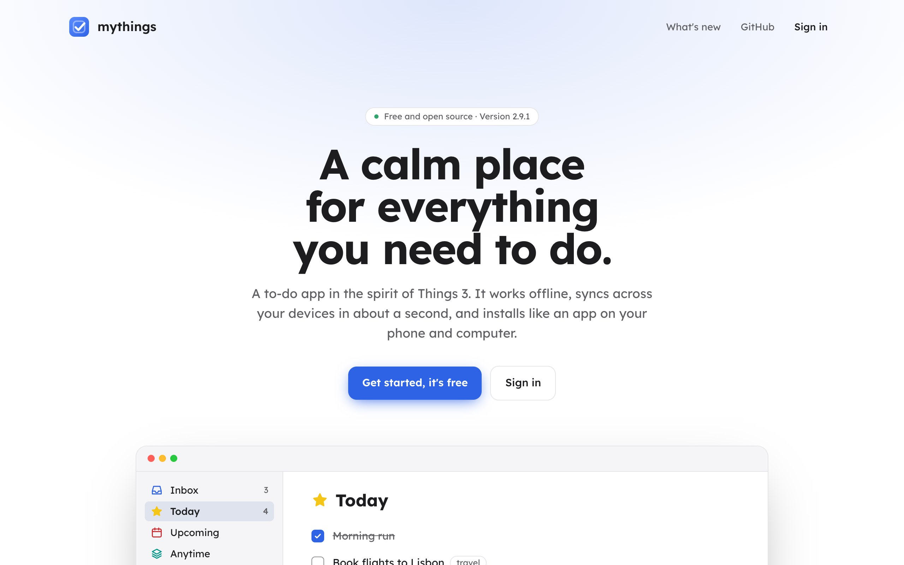

What's on it:

- **The top bar:** the mythings logo, **What's new** (the [changelog](#19-public-pages)), **GitHub** (the source code) and **Sign in**.
- **Get started, it's free** opens [sign-up](#12-creating-an-account); **Sign in** opens the [sign-in form](#13-signing-in-and-out).
- **A working preview of Today.** Below the buttons is a small, live copy of the Today list ("Go on, tick something off."). You can tick its to-dos to get a feel for the app; nothing you do there is saved.
- Further down: a tour of the main features, and a footer with **What's new**, the **Privacy Policy**, the **Terms of Service** and the source code.

<details>
<summary>The whole home page</summary>

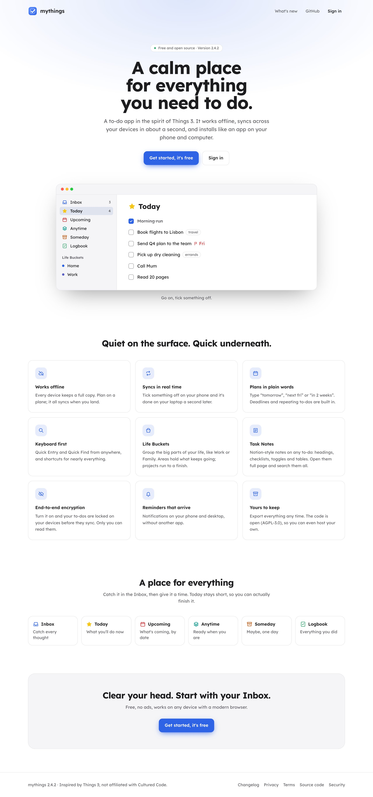

</details>

### 1.2 Creating an account

Signing up takes three short steps: tell us who you are, confirm your email, then choose a password on the page the email links to.

**Step 1: your name and email**

1. Choose **Get started, it's free** on the home page, **Create an account** under the sign-in form, or go to `/signup`.
2. Enter your **Name** (how mythings should address you) and your **Email**.
3. Choose **Create account**. By doing so you agree to the Terms of Service and Privacy Policy, which are linked right under the button.

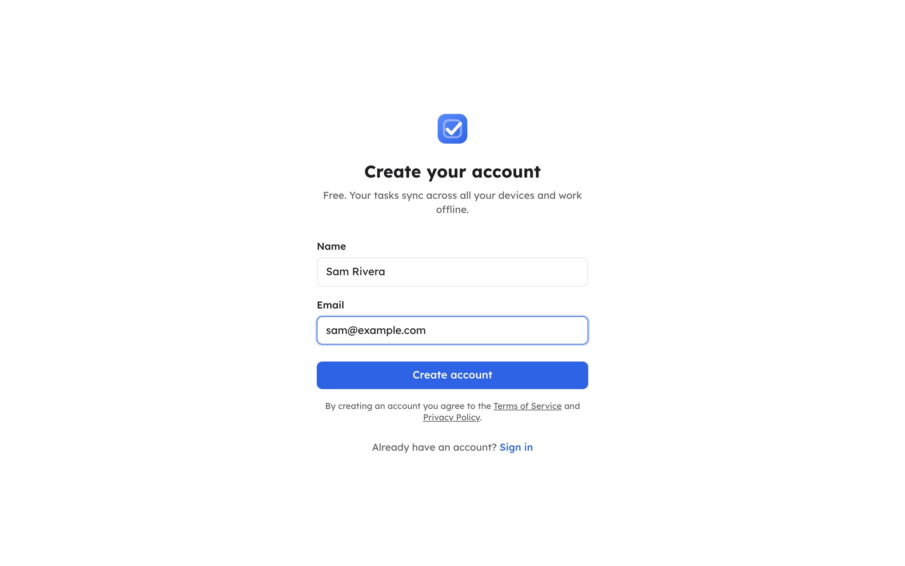

**Step 2: check your email**

A **Check your email** screen appears, showing the address we sent the link to. No account exists yet at this point.

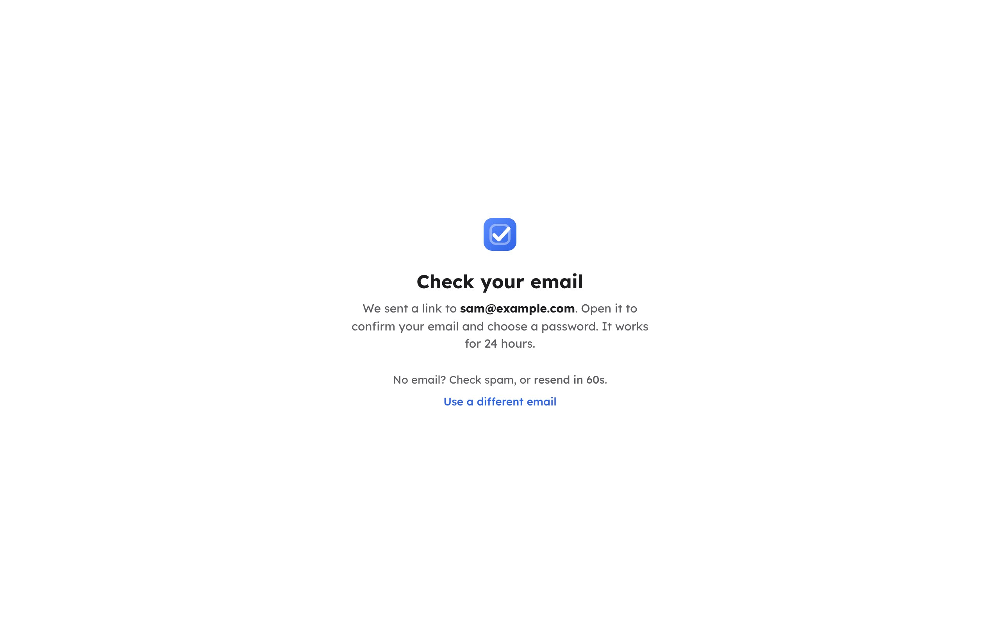

- **No email?** Check your spam folder. After a short wait the screen lets you send it again.
- **Typed the wrong address?** Choose **Use a different email** to go back to step 1.

**Step 3: choose your password**

Open the link in the email. The **Finish creating your account** page shows the confirmed email address, your name (prefilled, so you can still change it) and a **Password** field.

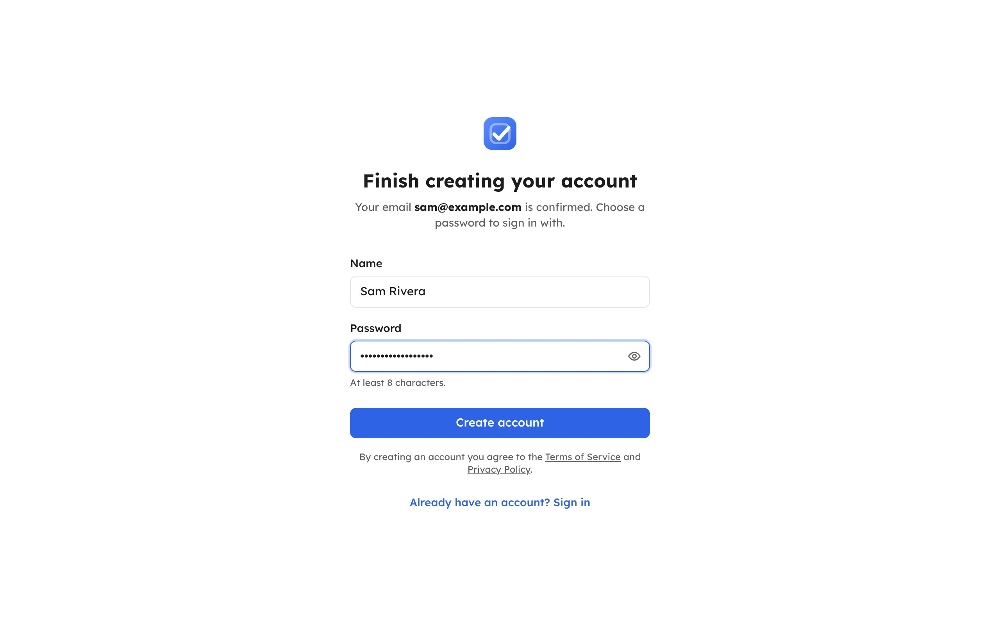

1. Choose a password of **at least 8 characters**. The eye icon shows or hides what you've typed.
2. Choose **Create account**.

You're signed in and taken to an empty Today, ready to go:

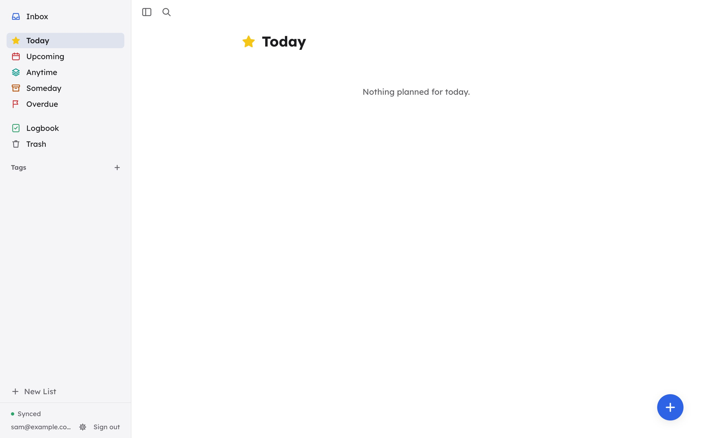

Good to know:

- You choose your password on the page the link opens, so nobody can sign up with your address and set a password for you.
- If the email already has an account, you get an email saying so instead, and the screen looks exactly the same. mythings never reveals which addresses have accounts.
- Links expire after a while and work only once. If one has expired or was already used, the page says so; start again from Sign up.
- If you ask for emails too often, you'll be asked to wait a little before trying again.
- Your password never leaves your device as you typed it: the app sends a key made from it instead. Nothing changes for you, but it's what makes [end-to-end encryption](#17-encryption-and-passcode) possible.

### 1.3 Signing in and out

**Signing in**

Go to `/login` (or choose **Sign in** on the home page), enter your **Email** and **Password**, and choose **Sign in**.

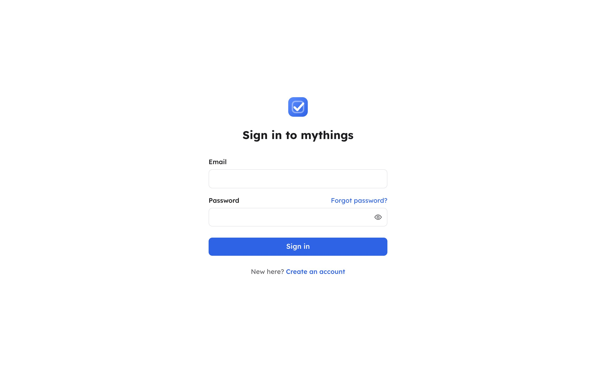

- **Forgot password?** (next to the Password label) starts a [password reset](#14-forgot-your-password).
- **New here? Create an account** switches to [sign-up](#12-creating-an-account).
- After several unsuccessful attempts you'll be asked to wait before trying again, or to reset your password.
- After a long time you'll be asked to sign in again, even on a device you use every day.
- If your account uses [end-to-end encryption](#17-encryption-and-passcode), signing in also unlocks your to-dos on that device: there's nothing else to type.

**Signing out**

**Sign out** is at the very bottom of the sidebar, next to your email and the Settings gear (and in **Settings → Account**). It always asks you to confirm. Signing out stops reminders being sent to this browser, and with encryption on it removes this device's ability to read your to-dos until you sign in again.

To sign out everywhere at once, use **Settings → Account → Sign out of all devices…**.

### 1.4 Forgot your password

1. On the sign-in page choose **Forgot password?**.
2. Enter your email and choose **Send reset link**. (**Back to sign in** returns to the form.)

   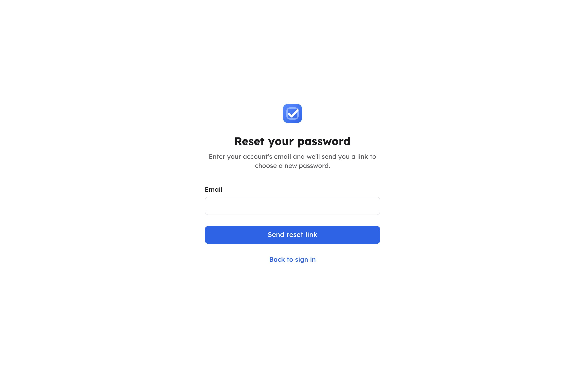

3. The screen confirms that if an account exists for that address, a link is on its way. It says the same either way, so nobody can use it to find out who has an account.
4. Open the link, choose a new password, and you're signed in.

Reset links also expire and work only once; ask for a new one if needed.

If you've turned on [end-to-end encryption](#17-encryption-and-passcode), a new password doesn't unlock your to-dos by itself: a device that's already unlocked keeps working (and updates your password for the others), and on any other device you'll be asked for your **recovery key** once. See [17.1](#171-end-to-end-encryption).

### 1.5 Installing the app

mythings is an installable web app (a PWA). Installing it is optional, but it's the nicest way to use it:

- **Desktop Chrome or Edge:** use the install icon at the right of the address bar, or install it from the browser menu.
- **iPhone or iPad (Safari):** Share → _Add to Home Screen_.
- **Android (Chrome):** menu → _Install app_ or _Add to Home screen_.

Installed, it:

- opens in its own window, with its own icon;
- works offline;
- can receive [reminders](#63-reminders) as notifications (on iPhone and iPad, only once installed);
- appears in the system share sheet, so you can share a link or text straight into [Quick Entry](#53-quick-entry);
- gets every keyboard shortcut, including a few that browsers keep for themselves in a normal tab.

### 1.6 Updates

The app updates itself. When a new version has downloaded it's applied straight away (or as soon as you stop typing, so nothing you're writing is interrupted), and a small toast says **Updated to version X**, with a **What's new** link. You never need to reload by hand. The version you're on is always shown in **Settings → About**.

### 1.7 Your first five minutes

A quick path through the essentials:

1. **Capture.** Press **Space** (or the blue **+** at the bottom right) and type a few things you need to do. In the Inbox they land in the [Inbox](#41-inbox); elsewhere they go into the list you're looking at.
2. **Decide.** Open each Inbox item and give it a **When**: Today, a date, Anytime or Someday ([6.1](#61-the-when-popover)). Add a **deadline** to anything that's actually due ([6.2](#62-deadlines)).
3. **Group.** Make a project for anything with several steps (**+ New List → New Project**), and group your lists into **Life Buckets** for the big parts of your life, such as Work and Home, with **areas** inside them for ongoing to-dos ([7](#7-projects-and-headings), [8](#8-life-buckets-and-areas)).
4. **Do.** Each morning open **Today**, drag things into the order you'll do them, and tick them off.
5. **Install** the app on your phone and computer ([1.5](#15-installing-the-app)) and turn on **notifications** if you want reminders ([6.3](#63-reminders)).

---

## 2. The screen at a glance

On a computer, the window has two parts: the **sidebar** on the left and the **main pane** on the right.

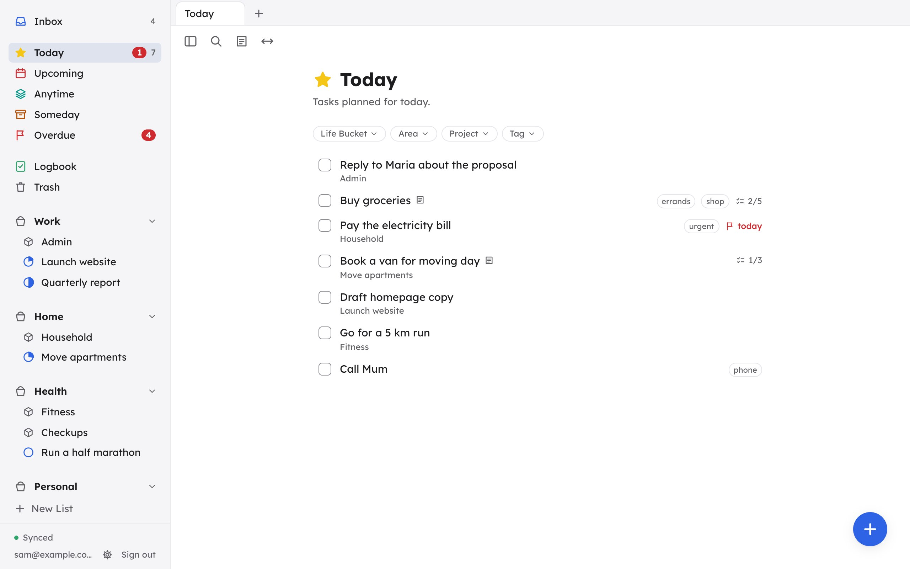

### 2.1 The sidebar

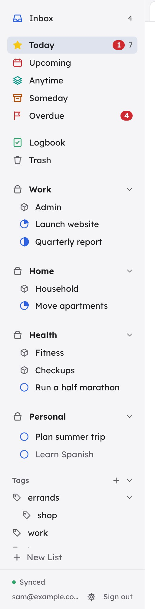

From top to bottom:

| Part | What it shows |
| --- | --- |
| **Inbox** | New to-dos you haven't decided on yet, with a count. |
| **Today** | What you plan to do today. The grey number counts its open items; the red badge counts those **due**. |
| **Upcoming** | Everything scheduled for a later date. |
| **Anytime** | Everything you could work on now. |
| **Someday** | Things you might do one day. |
| **Overdue** | Open items whose deadline has passed, with a red count. |
| **Logbook** | Completed and canceled items. |
| **Trash** | Deleted items, for 30 days. |
| **Life Buckets** | Each Life Bucket (here: _Work_, _Home_, _Health_, _Personal_) with its **areas** (cube icon) and then its **projects** (progress circle) underneath. The circle fills in as a project's to-dos are completed; a greyed-out project is set to Someday. The arrow next to a Life Bucket hides or shows what's inside. |
| **Tags** | Your tags, with nested tags indented under their parent (here: _shop_ inside _errands_). **+** adds a tag. The arrow next to **Tags** hides or shows the whole section, like a Life Bucket's; the arrow on a parent tag hides or shows its nested tags. |
| **+ New List** | Creates a project, an area or a Life Bucket. |
| **Footer** | The [sync status](#15-sync-offline-and-devices) (**Synced**, **Syncing** or **Offline**), your email, the **Settings** gear and **Sign out**. |

On a computer you can drag the sidebar's right edge to make it wider or narrower (double-click the edge to reset it); the width is remembered on that device. The **sidebar button** at the top left of the main pane hides or shows the sidebar.

### 2.2 The main pane

- **The top bar:** the sidebar button, the **search** icon, which opens [Quick Find](#12-finding-things-quick-find), the **Task Notes** icon, which opens [Task Notes](#57-task-notes), and on a computer the **Full width** button (↔), which lets every list use the whole window instead of a centered column. Click it again to go back. It's off to start with, and it's the same switch as [Settings → Appearance → Full width](#161-appearance).
- **The title** of the list, with its icon. Titles of projects, areas, Life Buckets and tags can be edited by clicking them; long titles wrap onto more lines.
- **Header details,** for projects, areas, Life Buckets and tags: notes, the Life Bucket a project or area belongs to, a project's When and deadline, tag chips and a **⋯** menu.
- **The tag bar:** a row of tag chips for [filtering the list](#410-filtering-a-list-by-tag).
- **The items,** in sections where the list has them (for example _This Evening_ in Today, or days in Upcoming).
- **The floating +** at the bottom right: adds a to-do to the list you're looking at.

### 2.3 Reading a to-do row

Each to-do is a row. From left to right it can show:

- the **checkbox** (square for to-dos; projects have a round progress ring instead);
- **★** if it's in Today (in lists other than Today);
- the **title**, with a small notes icon if it has notes. Long titles wrap onto more lines, so they're never cut off (or keep them to one line in [Settings → Appearance](#161-appearance));
- underneath, in grey, the **project or area** it belongs to (in Today, Upcoming, Overdue, Deadlines and the Logbook);
- on the right: its **tags**, **checklist progress** (like `2/5`), a **reminder time** (🔔 9:30 AM), the **deadline** (red when it's due today or overdue, otherwise like "10 days left"), and **↻** if it repeats.

---

## 3. Core ideas

### 3.1 To-dos

A to-do has:

- a **title**;
- optional **notes**, written in [Task Notes](#57-task-notes) with headings, lists, checkboxes, toggles, tables and more;
- an optional **checklist** of small steps;
- **tags**;
- a **When**: when you plan to work on it;
- an optional **deadline**: when it's due;
- an optional **reminder**: a notification at a time you choose;
- optionally a **repeat**.

It lives in the Inbox, an area or a project, and inside a project it can sit under a heading. (Life Buckets don't hold to-dos themselves.)

A to-do is **open**, **completed** or **canceled**. Completed and canceled to-dos move to the Logbook.

### 3.2 Projects

A project tracks work from start to finish toward an outcome: "Move apartments", "Launch website". It holds to-dos (optionally grouped under **headings**), has notes, its own When and an optional **deadline**, and shows a **progress ring** that fills as its to-dos are completed. Every project sits in a Life Bucket. When everything's done, you complete the project.

### 3.3 Life Buckets and Areas

- A **Life Bucket** is a big part of your life, like Work, Home or Health. It groups related **areas** and **projects** side by side. It doesn't hold to-dos itself.
- An **area** is work that keeps going and never "finishes": Admin, Household, Fitness. It holds to-dos and has **no deadline**. Every area sits in a Life Bucket.
- Use an area for what's ongoing, and a project for something you want to get done.

```
Life Bucket "Work"
├── Area "Admin"              (to-dos that keep coming)
├── Project "Launch website"  (to-dos toward an outcome, can have a deadline)
└── Project "Quarterly report"
```

Tags on a Life Bucket apply to everything inside it; tags on an area or project apply to its to-dos.

### 3.4 Headings

Headings split a project into sections ("Packing", "Utilities", "Moving day"). They can be reordered and archived.

### 3.5 Tags

Tags label to-dos, projects and areas across lists: `errands`, `phone`, `urgent`. Tags can be nested ("shop" inside "errands"); filtering by a parent tag includes everything tagged with the tags inside it. Items **inherit** tags from their project or area, and from its Life Bucket: if the _Work_ Life Bucket is tagged `work`, every to-do in its areas and projects counts as tagged `work` too.

### 3.6 When versus deadline

These are different on purpose:

- **When** is when you _intend to start_: Today, This Evening, a future date, Anytime, Someday, or not decided yet (Inbox).
- **Deadline** is when it's _due_. On the day it's due, a to-do shows up in Today even if its When is later, with a red flag. Once that day has passed, it moves to **Overdue** instead (see [Overdue](#46-overdue)).

For example, "Renew passport" could have a When of next week (when you'll start on the forms) and a deadline at the end of next month (when it must be done).

### 3.7 Where an item shows up

| When            | Shows in                                                      |
| --------------- | ------------------------------------------------------------- |
| Not decided     | Inbox                                                         |
| Today           | Today (and Anytime, with a ★)                                 |
| This Evening    | Today, in the **This Evening** section                        |
| A future date   | Upcoming, until that day arrives; then Today                  |
| Anytime         | Anytime                                                       |
| Someday         | Someday                                                       |

And, whatever its When:

| Deadline        | Also shows in                                                 |
| --------------- | ------------------------------------------------------------- |
| Today           | Today, with a red flag                                        |
| Passed          | Overdue (and no longer in Today, unless its When is Today)    |
| Any             | The hidden [Deadlines](#49-deadlines-hidden-list) list        |

To-dos inside a Someday project (or a project scheduled for later) stay out of Today and Anytime until the project itself is active.

---

## 4. The lists

Every list shows its items in order and most can be filtered with the **tag bar** under the title (see [4.10](#410-filtering-a-list-by-tag)).

### 4.1 Inbox

Where new to-dos land when you haven't decided anything about them yet: things you captured quickly, things shared from other apps, and anything you add while looking at the Inbox.

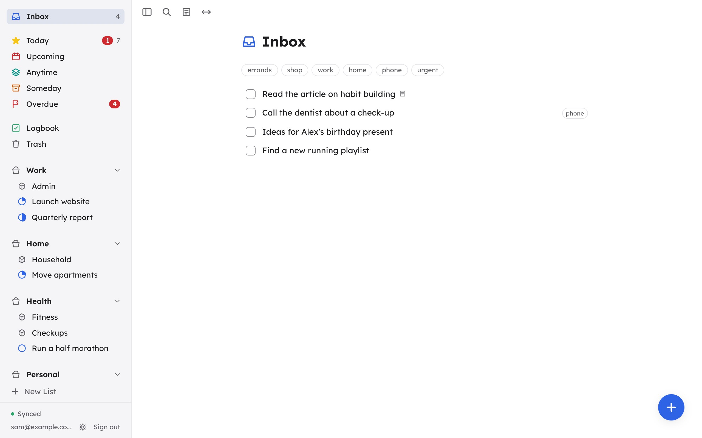

**Processing the Inbox.** Go through it regularly and, for each to-do, do one of these:

- give it a **When** (it leaves the Inbox for Today, Upcoming, Anytime or Someday);
- **move** it into a project or area (⌘⇧M, or drag it onto one in the sidebar);
- **complete** it, if it takes two minutes;
- **delete** it, if it no longer matters.

Reorder by dragging or with ⌘↑ / ⌘↓.

### 4.2 Today

Everything you plan to do today.


What's in it:

- To-dos and projects scheduled for today or earlier.
- Anything whose deadline is today, even if scheduled later (here, _Pay the electricity bill_ with its red **today** flag).
- A **This Evening** section (☾) for things you've set for this evening. While you drag, it appears even when empty so you can drop items into it.
- Once a deadline has passed, the item leaves Today and waits in [Overdue](#46-overdue). To work on it today anyway, set its When to **Today** (or This Evening): it then shows in both, with its overdue deadline in red.

Details:

- **Order** is your own, separate from each project's order. Drag rows, or use ⌘↑ / ⌘↓. Items that arrive in Today on their own (a scheduled date comes round, a deadline arrives) appear at the top.
- **Where each item belongs** shows in grey under its title (_Work_, _Move apartments_…).
- **Group to-dos in Today by project** (Settings → Lists) shows loose items first, then a small heading per project with its to-dos. While grouped, moving a to-do keeps it within its project's group.

  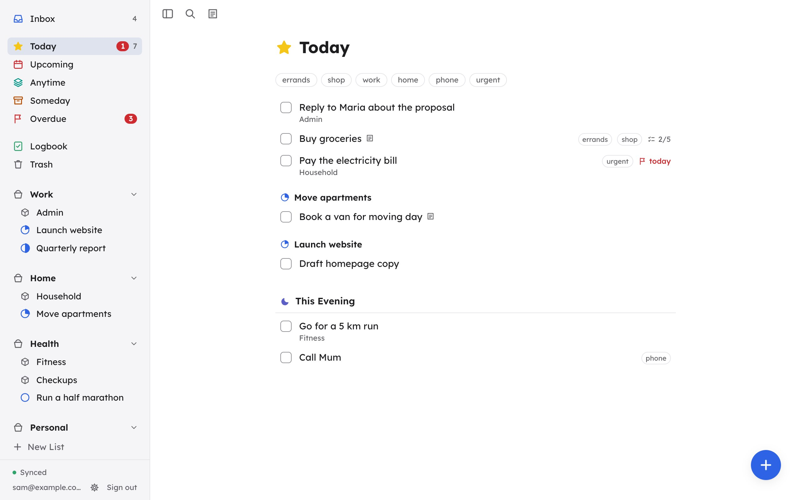

- **Tag bar:** offers only the tags that something in Today has. If a filter leaves nothing, it says "Nothing in Today has these tags."
- **A new day:** at midnight Today moves on. If your computer was asleep at midnight, Today catches up as soon as you come back to the app. Anything scheduled for "This Evening" yesterday comes back as a normal Today item.
- **The sidebar badges:** the grey number counts open items in Today; the red badge counts those that are due (today, or overdue items you've scheduled for today).

### 4.3 Upcoming

What's scheduled for later.

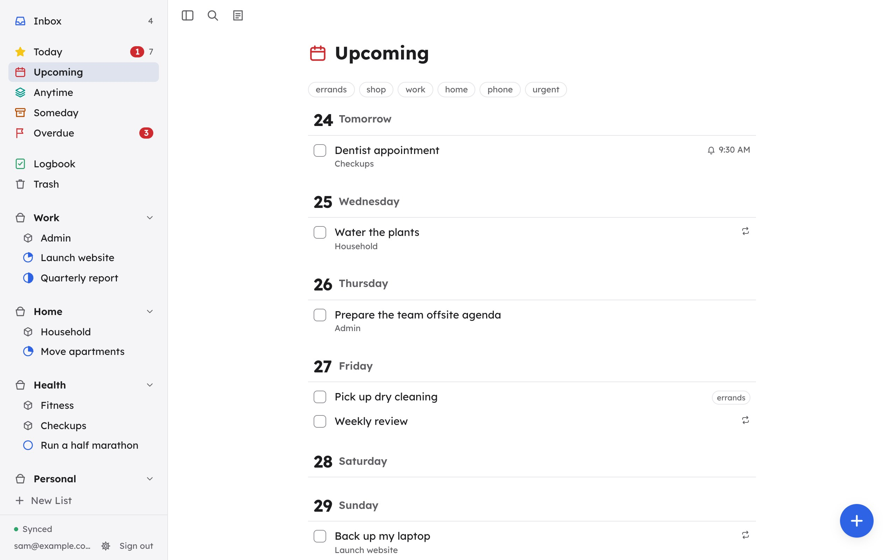

- The next seven days, each with its own header: the day of the month in large type, then "Tomorrow" or the weekday. Empty days still show, so you can see your week at a glance.
- Then the rest of the month, then one group per month.
- **Repeating** to-dos and projects appear on their next date with a **↻** (here, _Weekly review_ and _Water the plants_).
- A **reminder** shows its time with a 🔔 (here, _Dentist appointment_ at 9:30 AM).
- Projects scheduled for later appear on their start date too.

The **+** button on Upcoming adds a to-do for tomorrow. Rows here can be dragged to the sidebar (for example onto Today, to do something early) but not reordered.

### 4.4 Anytime

Everything you could work on now.

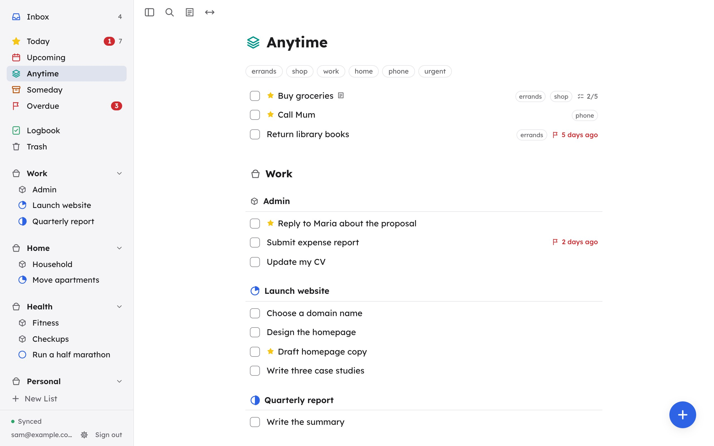

- To-dos set to Anytime, and scheduled ones whose day has come.
- Grouped as loose to-dos first, then each **Life Bucket**: its areas' to-dos, then its projects' to-dos.
- Items that are also in Today show a **★**.
- Active projects appear even if none of their to-dos are listed.
- Overdue items show how late they are in red ("5 days ago").

### 4.5 Someday

Things you might do one day, kept out of the way until you're ready.

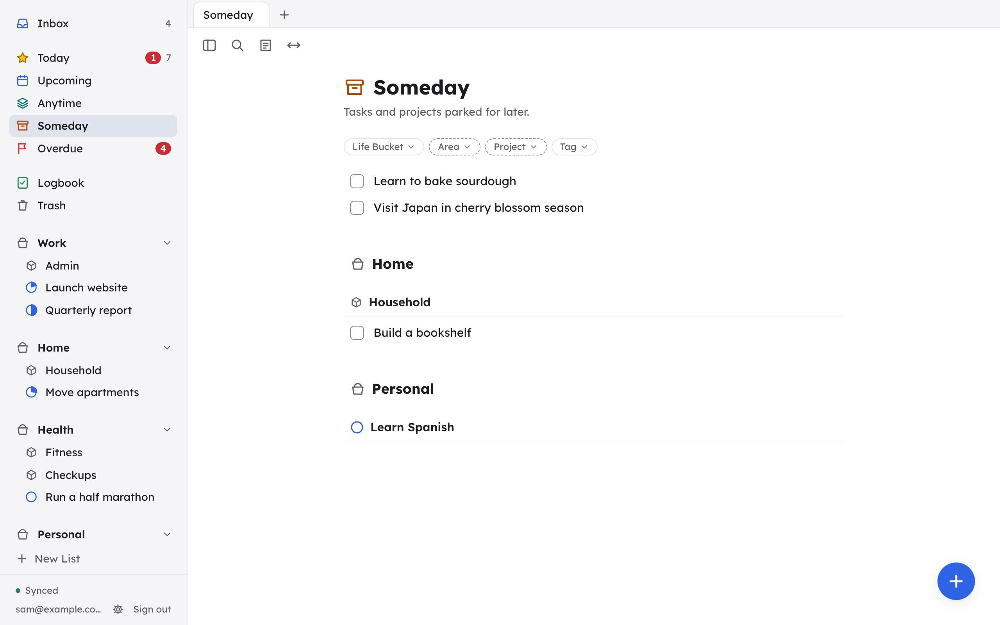

Someday projects appear as single entries (their to-dos stay inside them), plus Someday to-dos outside such projects, grouped by Life Bucket, area and project. When you're ready to start one, give it a When of Today, a date or Anytime.

### 4.6 Overdue

Everything whose deadline has passed and isn't done yet, so nothing late gets lost in Today. It sits in the sidebar after Someday, with a red count.

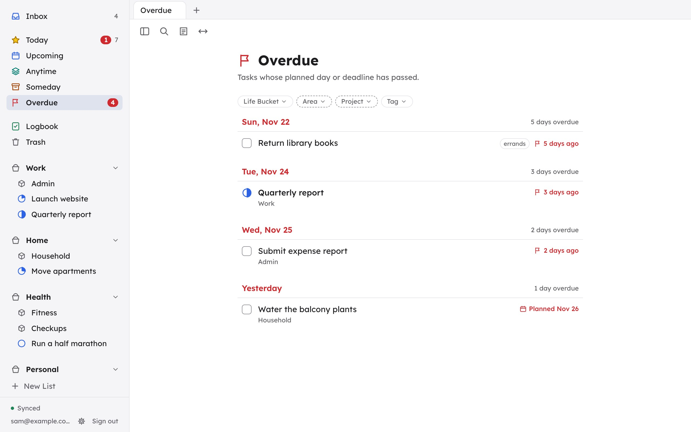

- Grouped by the day it was due, **most overdue first**. Each group says how late it is ("3 days overdue"), and each row shows its project or area.
- Projects with a passed deadline appear here too (here, _Quarterly report_), as do to-dos with any When (Anytime, Someday, a date, or none).
- Completed items, repeating templates and to-dos inside finished or deleted projects are left out. Tick one off and it leaves Overdue the same way it leaves other lists.
- To deal with something here:
  - **complete** it;
  - give it a later **deadline**: it leaves Overdue, and comes back to Today on the new day;
  - **clear** the deadline;
  - or set its When to **Today** to keep it in Today as well while it's still overdue.
- The **tag bar** offers only the tags that something overdue has.

Open it from the sidebar, with **g o**, or by typing "Overdue" in Quick Find.

### 4.7 Logbook

Completed and canceled items, newest first, grouped by the day they were finished ("Today", "Yesterday", then dates).

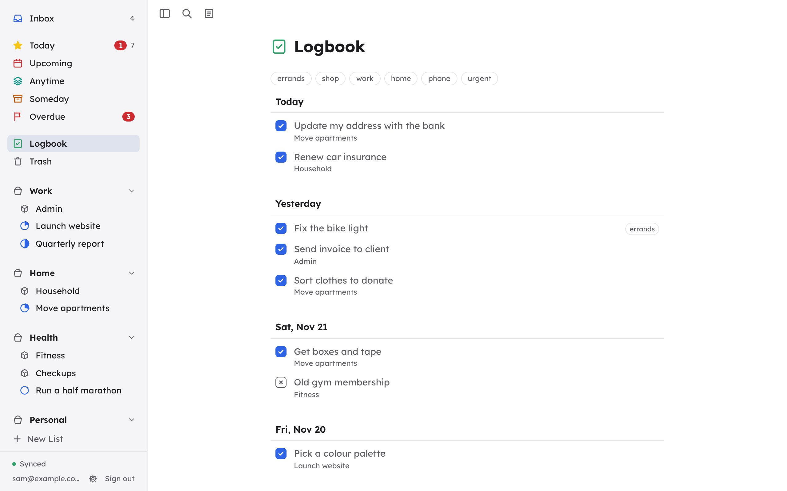

- Completed items have a ticked box; **canceled** ones have a crossed box and a line through the title (here, _Old gym membership_).
- A completed project's to-dos are filed under the project.
- **Untick** an item to reopen it; it goes straight back where it came from.
- Older entries load as you scroll.

When completed items move here depends on **Settings → Lists → Move completed to-dos to the Logbook**:

- **Immediately** (default): a completed to-do stays in place, struck through, for a moment, then leaves its list.
- **Daily:** completed items stay in their lists, ticked, until the end of the day.

### 4.8 Trash

Deleted items stay here for **30 days**, then they're deleted for good.

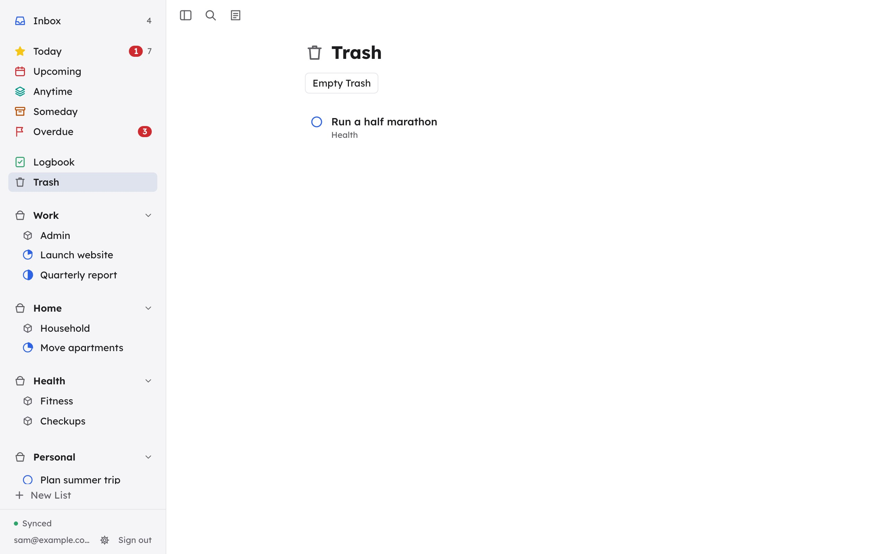

- Each item has **Restore**, which brings it back with everything that was deleted with it (a project's to-dos and headings, an area's to-dos, a Life Bucket's areas and projects).
- **Empty Trash** deletes everything here permanently; see [11.2](#112-trash).

### 4.9 Deadlines (hidden list)

Like in Things, Deadlines isn't in the sidebar: open **Quick Find**, type "Deadlines" and press Enter. It shows every open to-do and project that has a deadline, overdue or not (for only the overdue ones, use [Overdue](#46-overdue)).

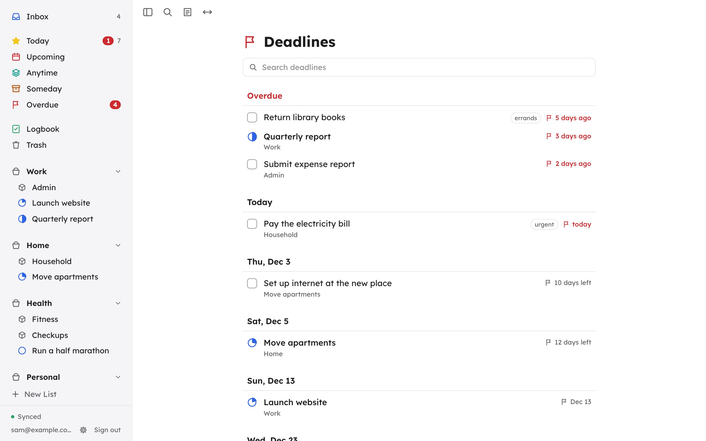

- **Overdue** first (in red), then one group per deadline day ("Today", "Tomorrow", then dates).
- Completed items, and to-dos inside finished or deleted projects, are left out.
- The **Search deadlines** box narrows the list to items whose title, notes, project, area or tags contain every word you type. Escape clears it.

### 4.10 Filtering a list by tag

Most lists have a **tag bar** under the title, listing the tags used by what's in the list. Click a tag to show only the items that have it:

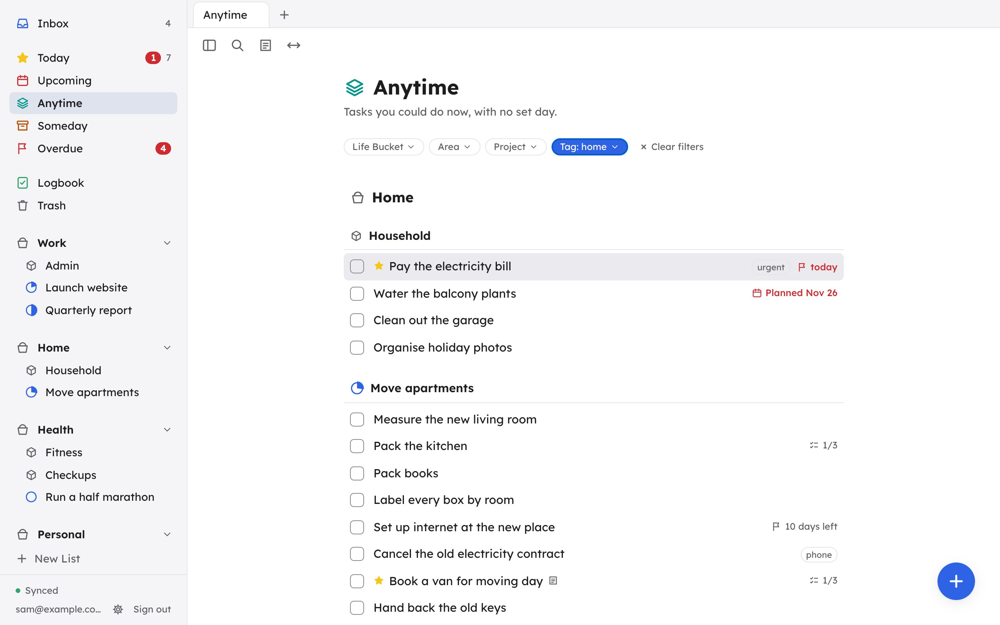

- Click more tags to narrow further: only items with **all** the selected tags (or tags nested inside them) remain.
- Click a selected tag again to remove it.
- Tags inherited from a Life Bucket, area or project count, so filtering by `home` here shows everything in the _Home_ Life Bucket.
- The filter is part of the page's address, so Back and bookmarks keep it.
- New to-dos you add while filtering get the selected tags, so they stay visible.
- While a filter is on, rows can't be reordered (they can still be dragged to the sidebar), so hidden items keep their places.

### 4.11 A project's, Life Bucket's, area's or tag's page

See [Projects and headings](#7-projects-and-headings), [Life Buckets and Areas](#8-life-buckets-and-areas) and [Tags](#9-tags).

---

## 5. Working with to-dos

### 5.1 Adding a to-do

There are several ways, depending on where you are:

- **The floating +** at the bottom right, or **Space** / **Alt+N** when nothing is being typed: adds a to-do to the current list and opens it, with the title ready for typing.
  - In **Upcoming** it's scheduled for tomorrow.
  - On a **project**, **area** or **tag** page it goes there (or gets that tag). A Life Bucket's page has no **+**: add to-dos to one of its areas or projects.
  - Tags selected in the **tag bar** are added, so it stays visible.
- With a to-do **selected**, **Space** adds the new one just below it.
- **Quick Entry** (Alt+Space) adds a to-do from anywhere, with shortcuts for tags, dates and projects; see [5.3](#53-quick-entry).
- **Sharing** from another app into the installed app opens Quick Entry prefilled.
- In a project, a heading's menu has **Add To-Do** to add one under that heading.

A new to-do you close while it's still completely empty is discarded.

### 5.2 The to-do card

Click a to-do (or select it and press **Enter**) to open it in place as a card:

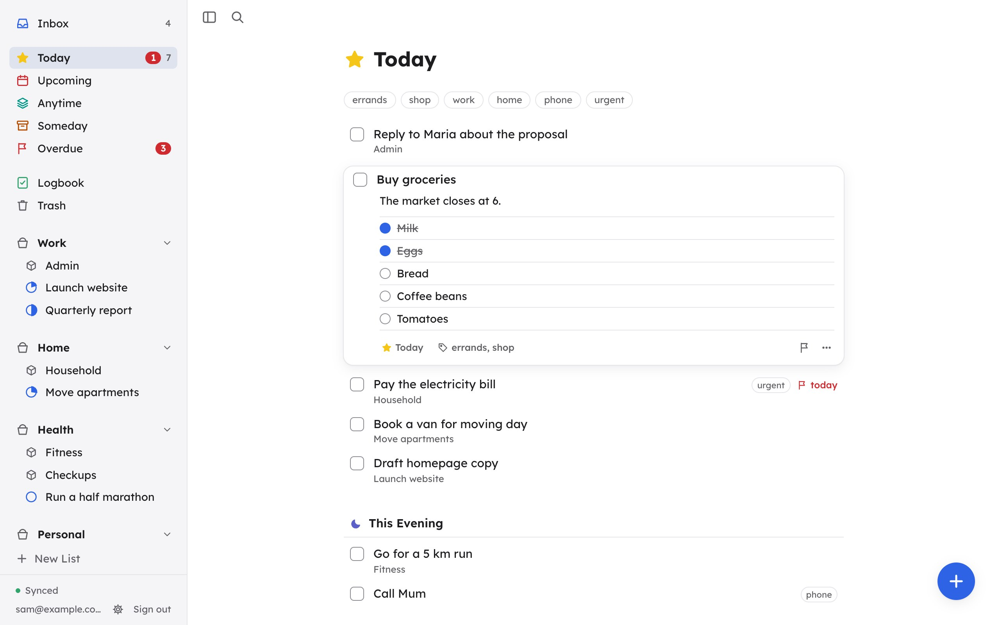

- **Title** at the top; a long title wraps onto more lines. Return closes the card.
- **Notes** below, in [Task Notes](#57-task-notes). Write freely, or type **/** for headings, lists, checkboxes, toggles, callouts, tables and more.
- **Checklist:**
  - **Add checklist** (in the footer) starts one; Return adds an item below the current one.
  - Backspace on an empty item removes it.
  - Long items wrap onto more lines as you type, so you can read every step in full.
  - Tick items off as you go (they're struck through). The collapsed row shows progress like `2/5`.
- **The footer** shows what's set and offers what isn't:
  - Set values appear as chips on the left: the **When** (★ Today here), the **list** it's in (a project, a heading in one, or an area), a **reminder** time, the **tags** (_errands, shop_) and the **deadline**. Click a chip to change it.
  - Icons on the right add what's missing: **When** (calendar), **Move** (for a to-do that isn't in a project or area yet), **Tags**, **Add checklist**, **Deadline** (flag), **Open in Task Notes** and **⋯ More actions**.
- Changes save automatically a moment after you stop typing, and when the card closes.
- Close it with Return in the title, **Escape**, **⌘Return**, or by clicking outside.

The **⋯ More actions** menu offers **Mark as Canceled** (or **Reopen** for a finished to-do) and **Delete To-Do**:

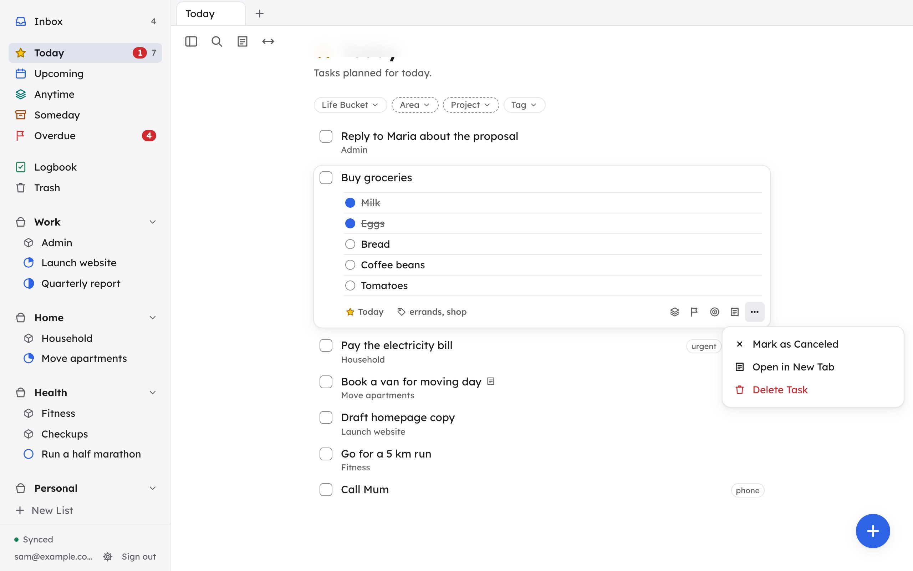

A repeating to-do's template shows **Repeats · next …** instead of its When; click it to [edit the repeat](#64-repeating-to-dos-and-projects).

### 5.3 Quick Entry

**Alt+Space** opens a centered box to add a to-do without leaving what you're doing. Fill in the title and notes, or type shortcuts straight into the title:

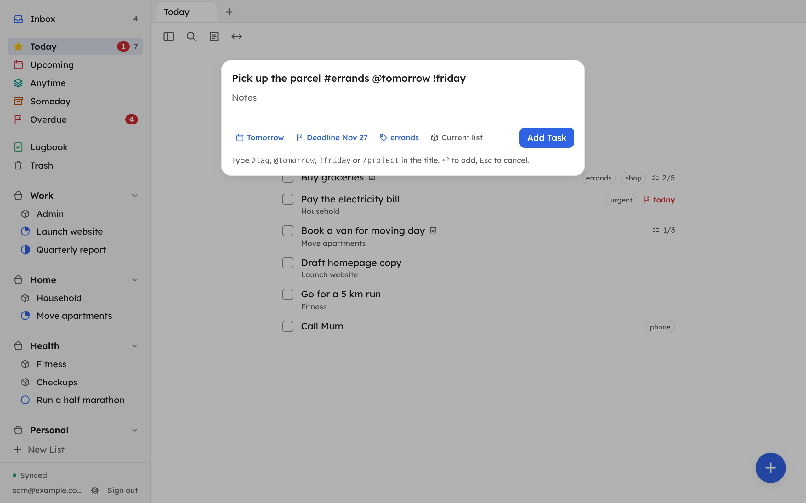

| Type in the title       | Does                                       |
| ----------------------- | ------------------------------------------ |
| `#errands`              | Adds the tag (created if it doesn't exist) |
| `@today`, `@tomorrow`   | Sets When                                  |
| `@someday`              | Sets When to Someday                       |
| `@next friday`, `@dec 3`| Schedules for that date                    |
| `!friday`, `!nov 30`    | Sets the deadline                          |
| `/Move`                 | Puts it in the project best matching "Move"|

- As you type, chips under the title show what was understood: in the example, **Tomorrow**, a **Deadline**, the tag **errands**, and **Current list** (where the to-do will go). The shortcuts are taken out of the title when it's added.
- Put shortcuts after the title; anything that isn't understood stays in the title.
- Without a `/project`, the to-do goes to the list you're on, or the Inbox.
- **Return** or **Add To-Do** adds it; **Escape** cancels.

**Sharing into mythings:** with the app installed, share a page or text from another app to mythings and Quick Entry opens prefilled (a link goes into the notes).

### 5.4 Completing and canceling

- **Complete:** tick the checkbox (or **⌘K**). The item is struck through and, a moment later, leaves the list for the Logbook. Untick it within that moment to keep it.
- **Cancel:** ⌘⌥K, or **Mark as Canceled** in the card's ⋯ menu, for things you decided not to do. It also goes to the Logbook, with a crossed box.
- **Reopen** anything from the Logbook, or from a project's or tag's logged items, by unticking it.
- Completing a copy of a [repeating](#64-repeating-to-dos-and-projects) to-do doesn't stop the repeat; the next copy appears on its next date.

### 5.5 Moving a to-do

- **From the open to-do:** click the chip with the list it's in (or the **Move** icon, for a to-do in the Inbox or no list yet). A message confirms where it went ("Moved to Admin").
- **Move to list** (⌘⇧M, or **Move** in the bar that appears for selected to-dos) opens the same picker for everything selected.
- **The picker** lists the Inbox, then each Life Bucket with its areas and projects under it, and each project's headings under the project. The list a to-do is in now is shown in bold. Type to search them all; each result shows where it is (_Work › Launch website_). It goes to the end of the list you choose.

  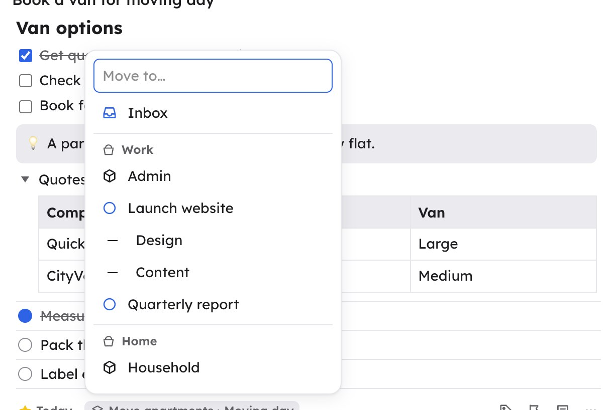
- **Drag** it onto a list in the sidebar; see [Drag and drop](#103-drag-and-drop).

### 5.6 Tags on a to-do

The Tags button (or chip) on the card, or **⌘⇧T**, opens the tag picker:

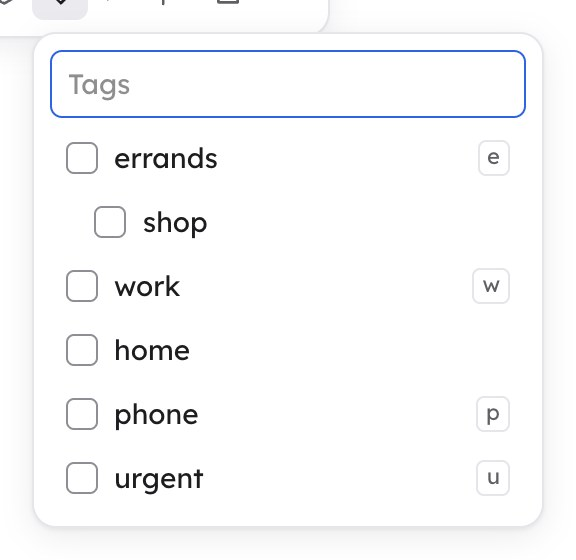

- **Type** to find a tag; if none matches, you can create it from there.
- **Click** a tag to add or remove it. Nested tags are indented under their parent.
- A tag's **shortcut key** (shown on the right, like `e` for _errands_) toggles it while the search box is empty (Shift types the letter instead). Set shortcuts on the [tag's page](#94-a-tags-page).

### 5.7 Task Notes

**Task Notes** are every to-do's notes: a place to explore and write as much as you need, Notion-style. Write in the open to-do, or open it as a full page.

**Writing.** An empty line shows a hint, **Type / for blocks**. Type **/** anywhere to insert a block, then keep typing to narrow the list, use ↑ / ↓ and **Enter**, or click one. Escape closes the menu.

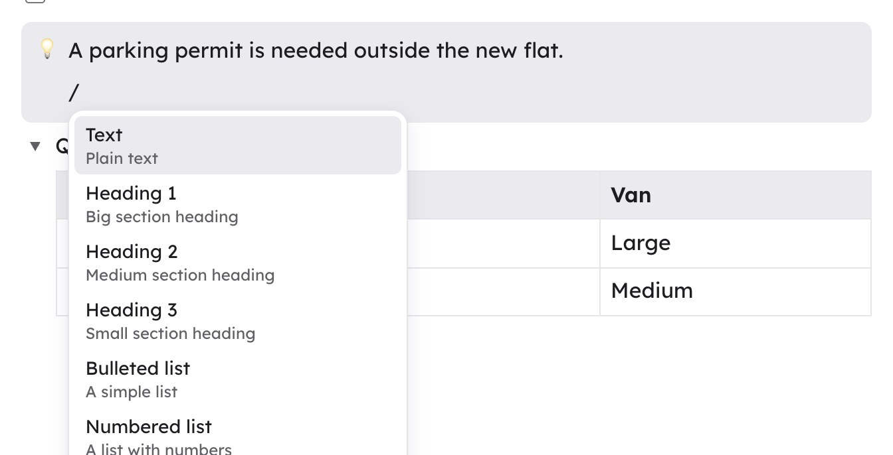

| Block          | What it's for                                     | Shortcut while typing |
| -------------- | ------------------------------------------------- | --------------------- |
| Heading 1–3    | Sections                                          | `# `, `## `, `### `   |
| Bulleted list  | A simple list                                     | `- `                  |
| Numbered list  | Steps in order                                    | `1. `                 |
| To-do list     | Checkboxes to tick off                            | `[ ] `                |
| Toggle         | A line you can open to show more under it         |                       |
| Callout        | A highlighted box for something to notice         |                       |
| Quote          | A quotation                                       | `> `                  |
| Code           | A block of code                                   | ` ``` `               |
| Table          | Rows and columns                                  |                       |
| Divider        | A line between sections                           | `---`                 |

- **Bold**, _italic_, ~~strike~~ and `code`: ⌘B, ⌘I, ⌘⇧S and ⌘E, or type them with `**`, `*`, `~~` and backticks. Web addresses become links as you type or paste them.
- **Toggles:** the first line is always shown; click the arrow to show or hide the rest. Whether it's open is saved.
- **Tables:** while the cursor is in a table, buttons below it add or delete rows and columns, or delete the table. Tab moves to the next cell (and adds a row at the end).
- **Checkboxes** in Task Notes are part of your notes. They're separate from the to-do's [checklist](#52-the-to-do-card), which shows progress on the row.

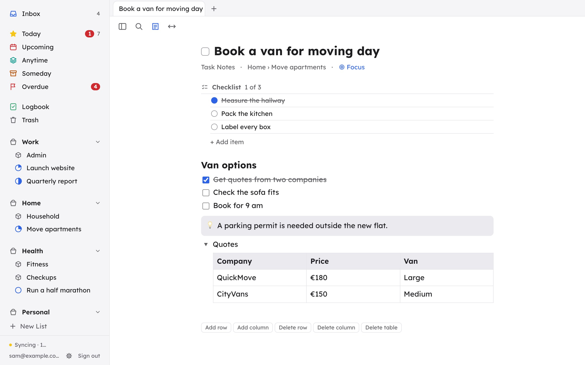

**The full page.** Click **Open in Task Notes** (the notes icon at the bottom of an open to-do) to write on a whole page. Its title is the to-do's title (long titles wrap), which you can edit, with a checkbox to complete it. Under it are links back to Task Notes and to the list the to-do is in. Changes save a moment after you stop typing, and when you leave.

**The Task Notes page.** The **Task Notes** icon at the top of every page (or **g n**, or "Task Notes" in Quick Find) lists every to-do that has notes, most recently changed first. Each shows its title, where it is and the start of its notes. The search box finds words anywhere in titles and notes; a match shows the part of the notes it was found in. Click one to open its full page. To-dos in the Trash aren't listed.

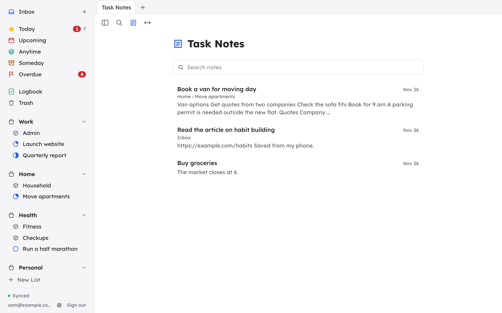

**Good to know:**

- Notes written before Task Notes open just as they were, including Markdown you typed.
- With [encryption](#171-end-to-end-encryption) on, Task Notes are encrypted like every other note, and searching them happens on your device.
- Notes stay with their to-do: they're copied when a to-do [repeats](#64-repeating-to-dos-and-projects), go to the Logbook and Trash with it, and are included when you [export](#18-your-data).

---

## 6. Scheduling: When, deadlines, reminders and repeats

### 6.1 The When popover

Open it from a to-do's **When** button or chip, **⌘S**, or by swiping right on a phone.

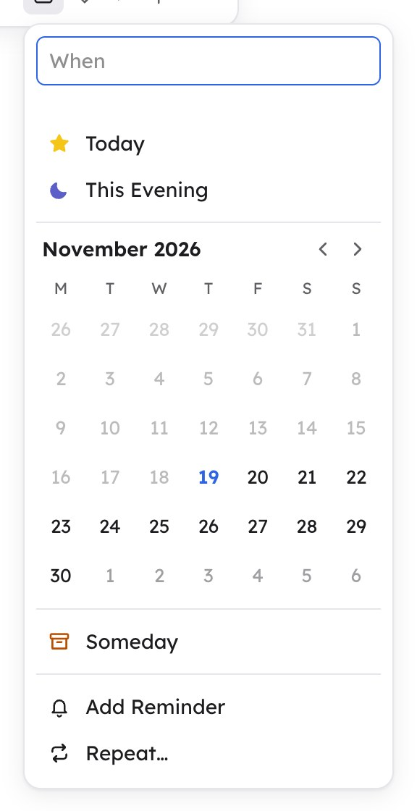

It offers:

- A field where you can **type a date** in plain words: "tomorrow", "tmrw", "next fri", "in 2 weeks", "dec 3", "tonight", "someday". A preview shows what it understood; press Enter to set it.

  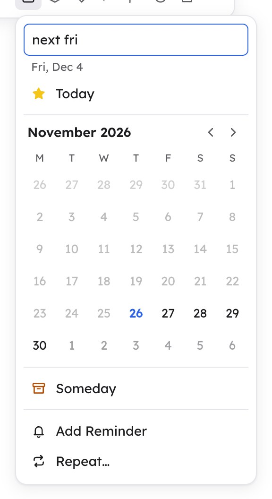

- **Today** ★ and **This Evening** ☾.
- A **calendar** for any future date (‹ and › change the month; today is in blue; past days are greyed out).
- **Someday**, and **Clear** to remove the date (shown when one is set).
- **Add Reminder** and **Repeat…** (below).

Keyboard shortcuts set When directly, without the popover: **Alt+T** Today, **Alt+E** This Evening, **Alt+R** Anytime, **Alt+O** Someday.

### 6.2 Deadlines

Open with the **Deadline** (flag) button or chip, or **⌘⇧D**.

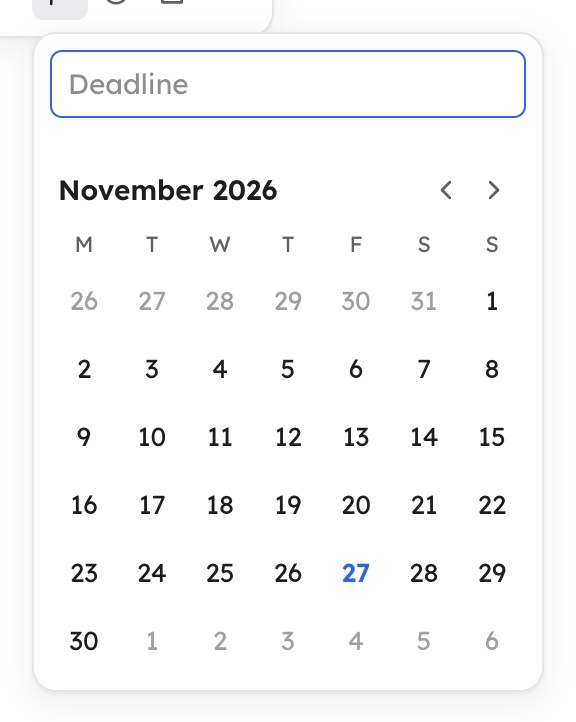

- Type a date ("friday", "nov 30") or pick it on the calendar.
- **Clear deadline** removes it (shown when one is set).
- On a project or card the deadline reads like **Deadline Dec 1 · 12 days left**, and turns red on the day it's due.
- Items due today appear in Today with a red flag; once the day has passed they move to [Overdue](#46-overdue). Every deadline is collected in the [Deadlines list](#49-deadlines-hidden-list).

### 6.3 Reminders

A reminder is a notification at a time you choose, on the day the to-do is scheduled for.

1. In the When popover choose **Add Reminder** (if the to-do has no date yet, the reminder is for today).
2. Pick a time and choose **Save**. **Back** returns to the When popover without a reminder.

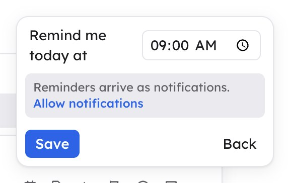

At that time you get a notification on every device where you've allowed notifications, even if the app is closed. Clicking it opens the to-do's project, or Today.

- If this browser hasn't allowed notifications yet, the picker says so, with **Allow notifications**. You can also turn them on in **Settings → Notifications**.
- The reminder shows on the row (🔔 9:30 AM) and as a chip on the card; click the chip to change or remove it.
- If you move the to-do to another day, the reminder moves with it (same time). Removing the date removes the reminder.
- A reminder that was missed by a long time (say every device was off) isn't sent late.
- With [encryption](#17-encryption-and-passcode) on, devices that can read your to-dos show the title; a locked device shows only that a to-do is due.

### 6.4 Repeating to-dos and projects

Choose **Repeat…** in the When popover (or, for something that already repeats, click its **Repeats · next …** chip). The repeat editor:

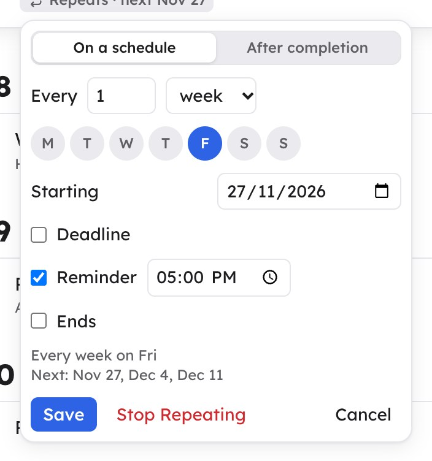

**Two kinds of repeat** (the switch at the top):

- **On a schedule:** on fixed dates, whether or not you finished the last one.
  - every N **days**;
  - every N **weeks**, on the weekdays you pick (M T W T F S S);
  - every N **months**, on a day of the month, the last day, or "the 2nd Tuesday" / "the last Friday";
  - every N **years**, on a date.
- **After completion:** the next one is due N days, weeks, months or years after you finish the current one. Good for things like watering plants or backing up a laptop, where the gap matters more than the date.

**Options:**

- **Starting:** the date of the next one.
- **Deadline:** gives each one a deadline a number of days after it starts.
- **Reminder:** a time to be reminded on each one.
- **Ends:** an end date, after which no more are made.

A **summary** at the bottom describes the rule in words and lists the next dates, so you can check it before saving. **Save** saves it, **Stop Repeating** turns the repeat off, and **Cancel** closes without changes.

How it behaves:

- The repeating item itself is a **template**: it doesn't appear in normal lists, only in **Upcoming** on its next date (with ↻), in its project's **Repeating** section and on its tags' pages.
- On the day, a fresh **copy** appears (in Today) with the same title, notes, checklist, tags and place. A repeating project copies its headings and open to-dos too.
- Only one copy is created at a time. If you were away for a while, you get the latest one, not a backlog.
- "Every N weeks" counts weeks starting on your chosen first day of the week (Settings → Date & time).
- Edit or stop a repeat from the template (in Upcoming or the project). Changing a copy doesn't change the template.

---

## 7. Projects and headings

### 7.1 Creating a project

Choose **+ New List** at the bottom of the sidebar, then **New Project** ("Work toward an outcome, from start to finish. Can have a deadline."):

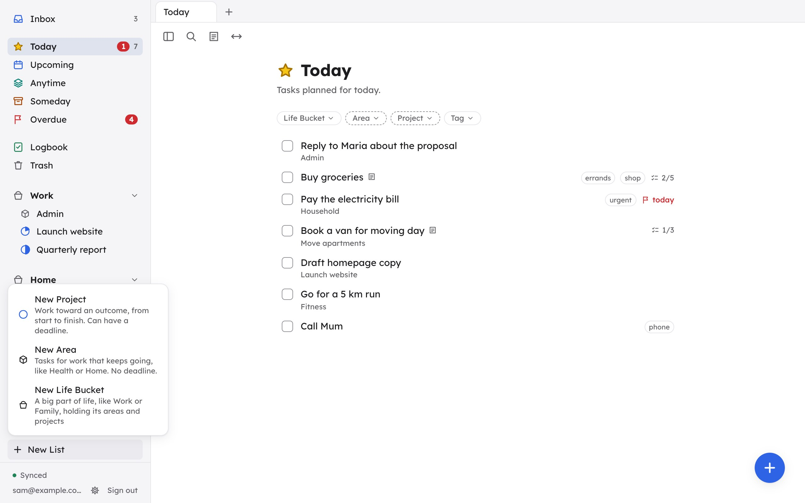

The new project opens with its title ready to type. It goes into the Life Bucket you're looking at (or the one holding the area or project you're on), otherwise into your first Life Bucket. A Life Bucket's ⋯ menu also has **New Project in Life Bucket**.

### 7.2 A project's page

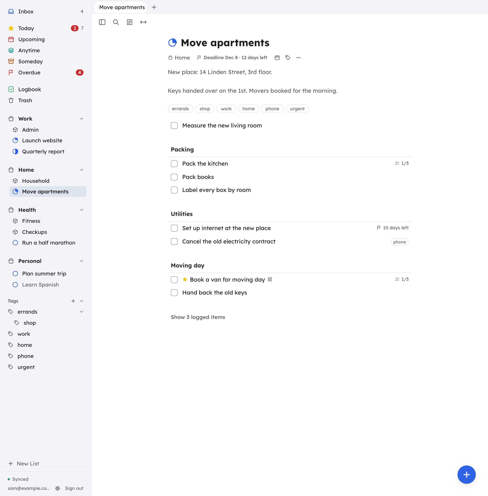

From top to bottom:

- **Title** (click to edit) with the **progress ring** next to it. The ring fills in as to-dos are completed.
- **Details** under the title: the **Life Bucket** it belongs to (click it to go there), its **deadline** ("Deadline Dec 1 · 12 days left"), and buttons for **When**, **Tags** and the **⋯** menu.
- **Notes**, in Markdown (here, the new address and moving-day plans).
- The **tag bar**.
- **Loose to-dos** (not under any heading).
- Each **heading** with its to-dos.
- A **Repeating** section for repeat templates in the project.
- **Archived headings** at the bottom, collapsed.
- **Show N logged items** at the very end: the project's completed and canceled to-dos, newest first with the day they were done. Untick one to bring it back. It starts hidden each time you open the project; **Hide logged items** hides it again.

  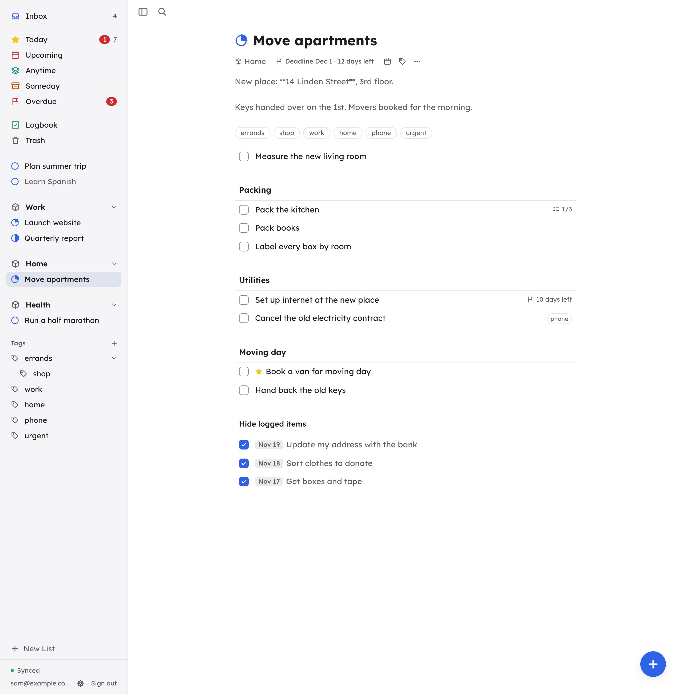

The **+** button and Space add to-dos to the project.

**The project's ⋯ menu:**

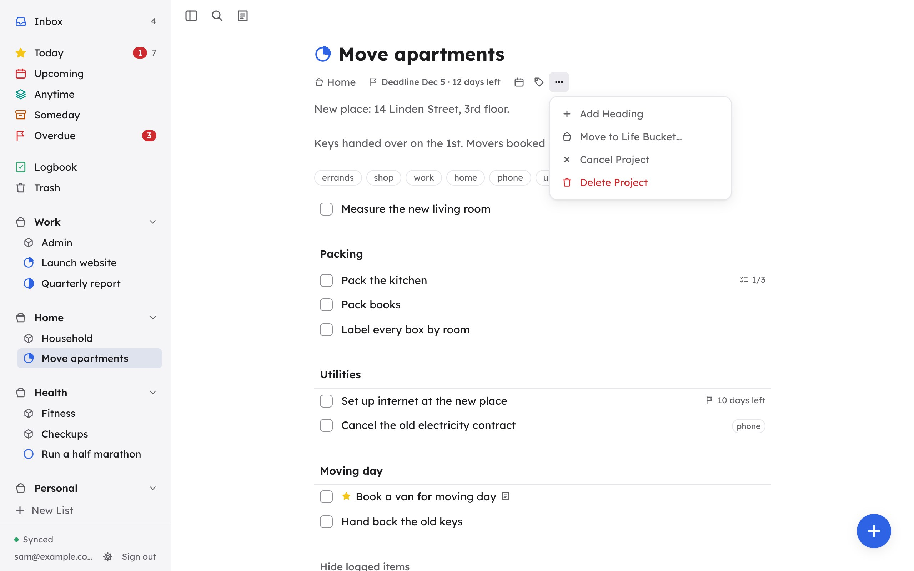

- **Add Heading**
- **Move to Life Bucket…** (when you have more than one)
- **Cancel Project** (or **Reopen Project** when it's finished)
- **Delete Project**

### 7.3 Completing, canceling and reopening a project

- Click the **progress ring** next to the title to complete the project. If open to-dos remain, you're asked what should happen to them:

  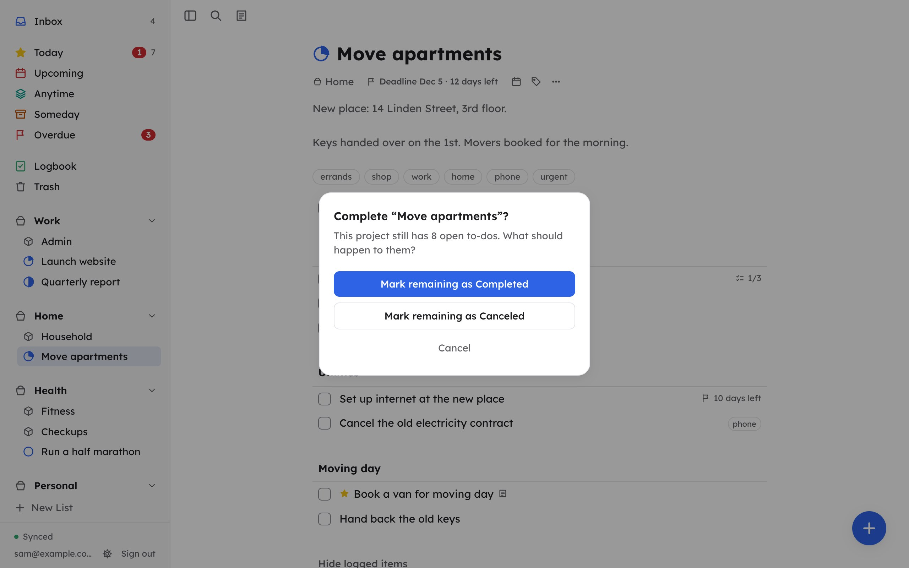

  Choose **Mark remaining as Completed** or **Mark remaining as Canceled**, or **Cancel** to keep working on it.
- **Cancel Project** (the ⋯ menu) cancels it and its remaining to-dos.
- **Reopen Project** (same menu), or unticking it in the Logbook, reopens it and leaves its to-dos as they were.

### 7.4 Moving a project

- **Move to Life Bucket…** in the project's ⋯ menu moves it to another Life Bucket.
- In the sidebar, drag it onto a Life Bucket, or up and down to reorder it among its bucket's projects.

### 7.5 Headings

- **New heading:** **Add Heading** in the project's ⋯ menu, or **Alt+Shift+N** on the project's page.
- **Rename** by clicking its title.
- **The heading's ⋯ menu** (next to the heading):

  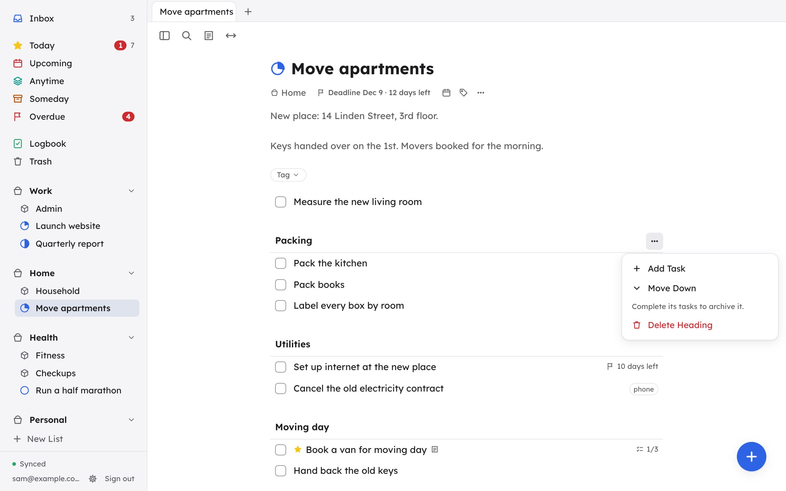

  - **Add To-Do** under this heading.
  - **Move Up / Move Down** to reorder it (its to-dos move with it). You can also drag a heading by its title.
  - **Archive**, once nothing under it is open (until then the menu says "Complete its to-dos to archive it."). It moves to the bottom of the project, collapsed, with its finished to-dos. **Unarchive** it from the same menu.
  - **Delete Heading** (it asks first); its to-dos go to the Trash with it.
- **Move to-dos** between headings (or out to the loose list) by dragging.

---

## 8. Life Buckets and Areas

### 8.1 Life Buckets

- **Create:** **+ New List → New Life Bucket** ("A big part of life, like Work or Family, holding its areas and projects"). Your first area or project, if you don't have a Life Bucket yet, goes into a new **Personal** one; rename it any time.
- **The Life Bucket's page:** its **Areas** (with how many open to-dos each has), then its **Projects** (with progress rings and deadlines), then **Show N logged items** for its finished projects. **+ New Area** under the areas and **+ New Project** under the projects add one right there, in this Life Bucket.

  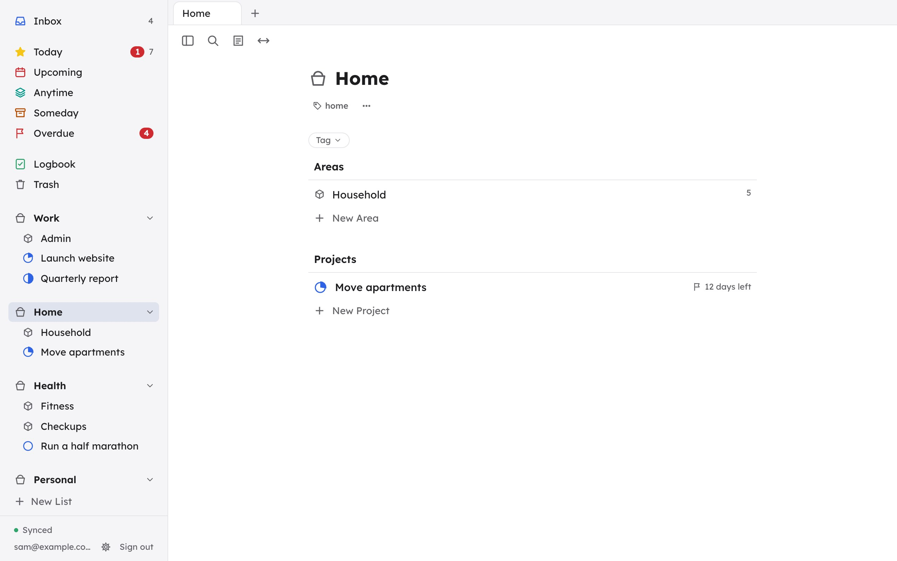

- **Rename** by clicking the title. **Tags** on a Life Bucket apply to everything inside it.
- **The Life Bucket's ⋯ menu:**

  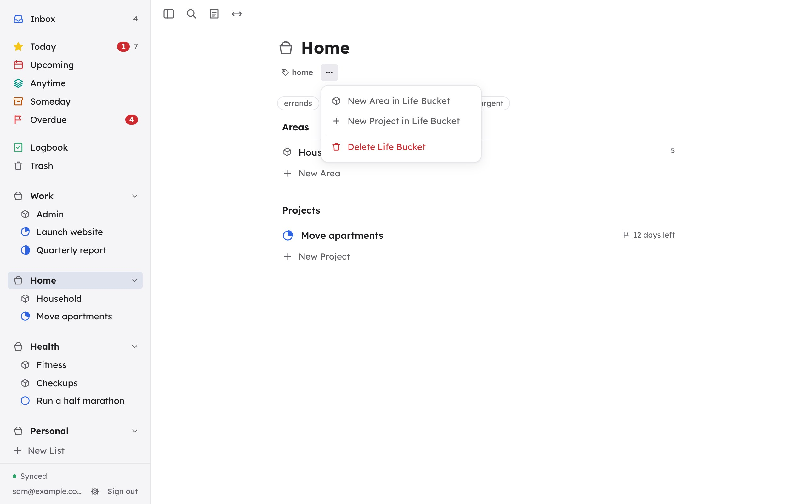

  - **New Area in Life Bucket**
  - **New Project in Life Bucket**
  - **Delete Life Bucket** (it asks first): its areas, projects and their to-dos go to the Trash with it, and Restore brings them all back. Your last Life Bucket can't be deleted, since every area and project needs one.
- **In the sidebar:** each Life Bucket shows its areas, then its projects. The arrow next to it hides or shows them, and a hidden bucket shows how many it holds. This is saved to your account, so it's the same on all devices. Opening one of its areas or projects (from search, a link or a new list) opens it again.
- **Reorder** Life Buckets by dragging them in the sidebar.

### 8.2 Areas

- **Create:** **+ New List → New Area** ("To-dos for work that keeps going, like Health or Home. No deadline."), or **New Area in Life Bucket** in a Life Bucket's ⋯ menu. It goes into the Life Bucket you're looking at, otherwise your first one.
- **The area's page:** its to-dos, then **Show N logged items** for finished ones. Areas have no deadline. A link under the title goes to its Life Bucket.

  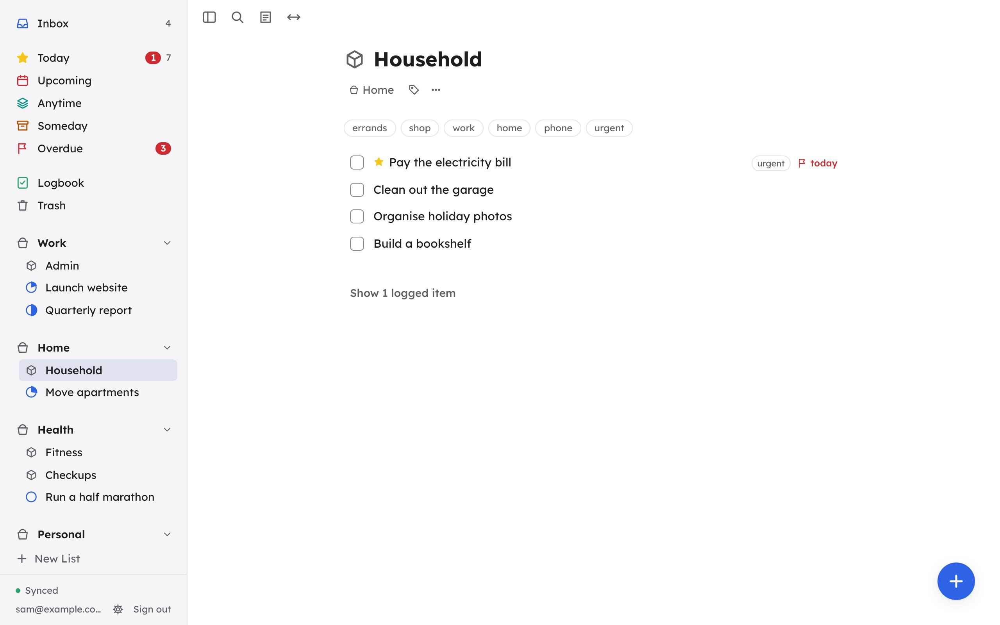

- **Rename** by clicking the title. **Tags** on an area apply to its to-dos.
- **The area's ⋯ menu:**

  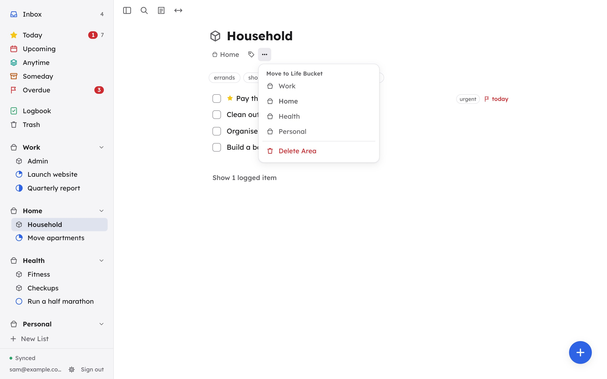

  - **Move to Life Bucket:** pick another Life Bucket (the current one is in bold).
  - **Delete Area** (it asks first): its to-dos go to the Trash with it.
- **In the sidebar:** drag an area onto another Life Bucket to move it there, or up and down to reorder it within its bucket.

### 8.3 After updating to Life Buckets

If you used mythings before Life Buckets, your lists were rearranged for you once, and nothing was lost:

- An area that held projects became a **Life Bucket** with the same name, keeping its projects. If it also had its own to-dos, they're now in an area of the same name inside it.
- Other areas, and projects that weren't in an area, are in a **Personal** Life Bucket.

You can rename, move or delete any of them.

---

## 9. Tags

### 9.1 Creating tags

- The **+** next to **Tags** in the sidebar opens a field: type a name and press Enter; it stays open for the next one. Escape closes it. Names that already exist aren't added twice.

  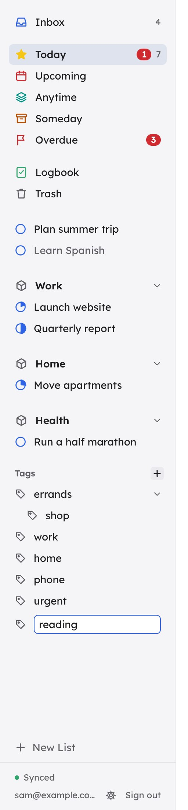

- Or type a new tag in any [tag picker](#56-tags-on-a-to-do), or `#name` in [Quick Entry](#53-quick-entry).

### 9.2 Nesting

In the sidebar, **drag a tag onto the middle of another tag** to nest it inside (a highlight shows where it will go). To take it out again, drag it next to a top-level tag, or right-click it and choose **Move out of "…"**. You can also use **Inside** in the **⋯** menu on a tag's page.

- A tag can't be nested inside itself or one of its own nested tags.
- Nested tags show indented under their parent, at any depth.
- A parent tag with nested tags gets an arrow to hide or show them; a hidden parent shows how many tags it holds. This is saved to your account.
- Visiting a nested tag opens everything above it again.
- The arrow next to the **Tags** heading hides or shows every tag at once, like a Life Bucket; while hidden, it shows how many tags there are. This is saved to your account, and visiting a tag (or adding one) shows them again.
- Filtering by a parent tag includes everything tagged with its nested tags.

### 9.3 Reordering tags

Drag a tag in the sidebar onto the **top or bottom edge** of another tag: a line shows where it lands, and it moves just above or below that tag (alongside it, under the same parent). The order is saved to your account. On a touch screen, press and hold a tag to start dragging.

### 9.4 A tag's page

Click a tag in the sidebar to open its page:

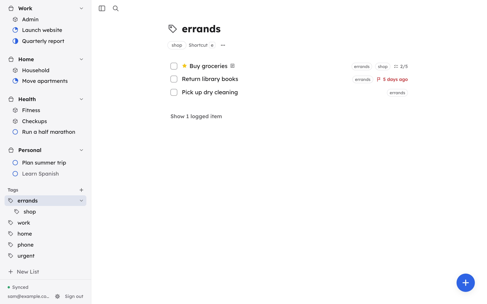

- **Chips** to the parent tag (↑) and the nested tags, plus the tag's shortcut key if it has one.
- Everything open with this tag, **including tags nested inside it**, grouped like Anytime (loose to-dos, then each Life Bucket with its areas and projects).
- **Repeating** to-dos and projects with the tag, soonest next date first.
- **Show N logged items** for what's already done.
- **The ⋯ menu:**

  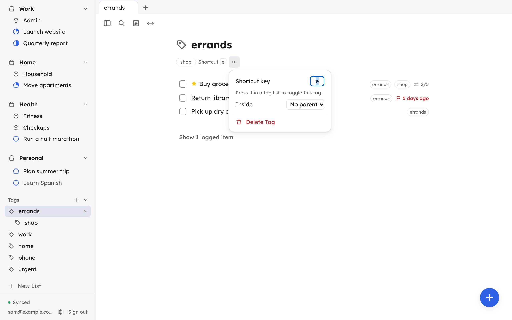

  - **Shortcut key:** a single letter that toggles this tag in any tag picker. A key used by another tag moves to this one.
  - **Inside:** the parent tag (or **No parent**).
  - **Delete Tag**.

### 9.5 Deleting a tag

Delete a tag in any of three ways:

- right-click it in the sidebar and choose **Delete Tag…**;

  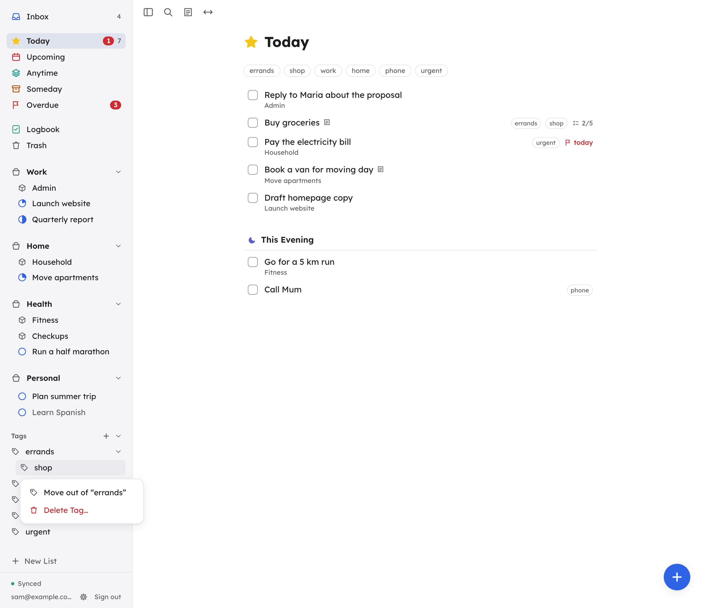

- drag it onto **Trash** in the sidebar;
- or use **Delete Tag** in the **⋯** menu on its page.

It asks first, saying how many items it will come off and how many tags nested inside it go too. The items themselves stay. Tags don't go to the Trash, so use **Undo** straight away if you change your mind. Deleting a tag also deletes the tags nested inside it.

---

## 10. Selecting, moving and reordering

### 10.1 Selecting

- **Click** a to-do to select and open it.
- **⌘-click** (Ctrl-click) to add or remove one from the selection; **Shift-click** to select a range.
- **↑ / ↓** move the selection; **Shift+↑ / ↓** extend it.
- **Escape** closes the card, then clears the selection.

### 10.2 Acting on several at once

With two or more selected, a bar appears at the bottom of the list:

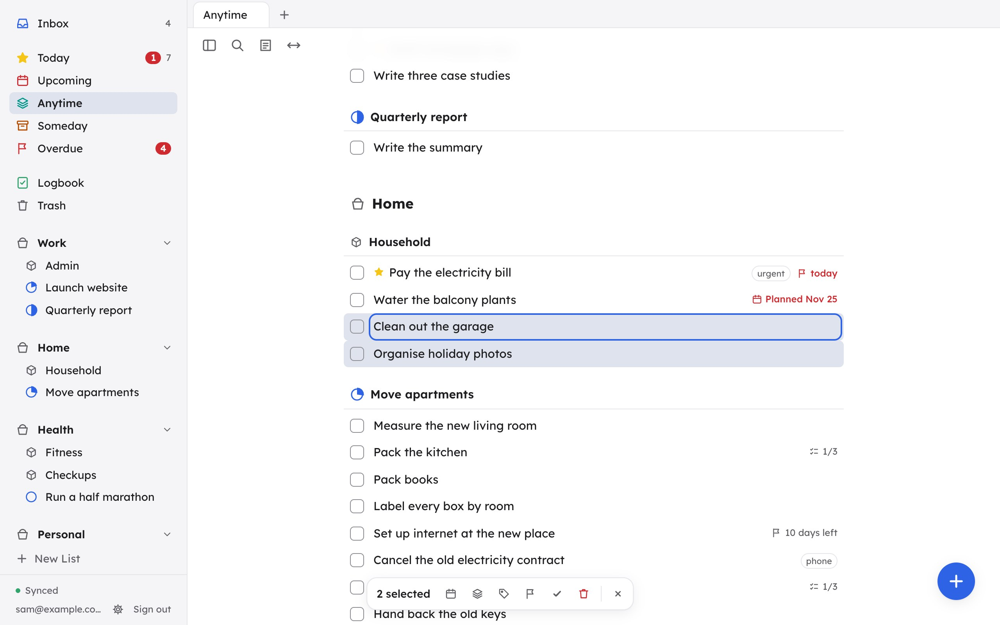

Its buttons, from left to right: **When**, **Move**, **Tags**, **Deadline**, **Complete** and **Delete**, then **✕** to clear the selection. Keyboard shortcuts (⌘S, ⌘⇧M, ⌘⇧T, ⌘⇧D, ⌘K, Delete) work on the whole selection too.

### 10.3 Drag and drop

- **Reorder** by dragging rows in the Inbox, Today and This Evening, a project's loose to-dos and each heading, an area's to-dos, a Life Bucket's areas and projects, and the sidebar's Life Buckets, areas, projects and tags.
- **Between sections on one page:** heading ↔ loose to-dos in a project; Today ↔ This Evening (scheduling for today when needed).
- **Onto the sidebar:**
  - **Inbox**, **Anytime**, **Someday**: sets that When.
  - **Today**: schedules for today and puts it at the top of Today.
  - **Logbook**: completes a to-do.
  - **Trash**: deletes (it asks first).
  - A **project** or **area**: moves a to-do there (to the end).
  - A **Life Bucket**: moves a project or area there (to the end).
  - **Tags** in the sidebar: drag a tag onto another to nest it, or onto its top or bottom edge to reorder (see [Tags](#9-tags)), or onto Trash to delete it.
  - Upcoming isn't a drop target; projects can't be dropped onto the Logbook (complete them from their ring, so you're asked about remaining to-dos).
- With the mouse, a drag starts after a small movement; on touch screens, press and hold.
- Rows in Anytime, Someday, Upcoming and tag pages can be dragged to the sidebar but not reordered there.

### 10.4 Keyboard reordering

**⌘↑ / ⌘↓** move the selected item up or down in its list (in Today grouped by project, within its group).

---

## 11. Deleting, Trash and Undo

### 11.1 Every delete asks first

Deleting anything opens a confirmation that says what goes with it (for example "It moves to Trash with its 3 to-dos and 2 headings"):

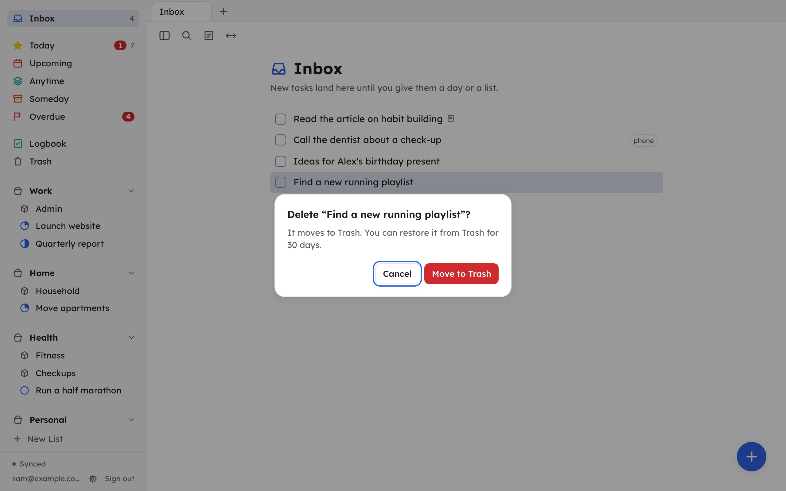

**Cancel** is focused, so Enter or Escape keeps everything; choose **Move to Trash** to go ahead. This applies to deleting from a card, the keyboard (Backspace / Delete), the bulk bar, menus, swiping left on a phone, and dragging onto Trash.

### 11.2 Trash

Deleted items wait in the [Trash](#48-trash) for 30 days and can be restored with everything deleted alongside them.

**Empty Trash** deletes them permanently, on all your devices. You must tick **I understand this can't be undone** before the button works:

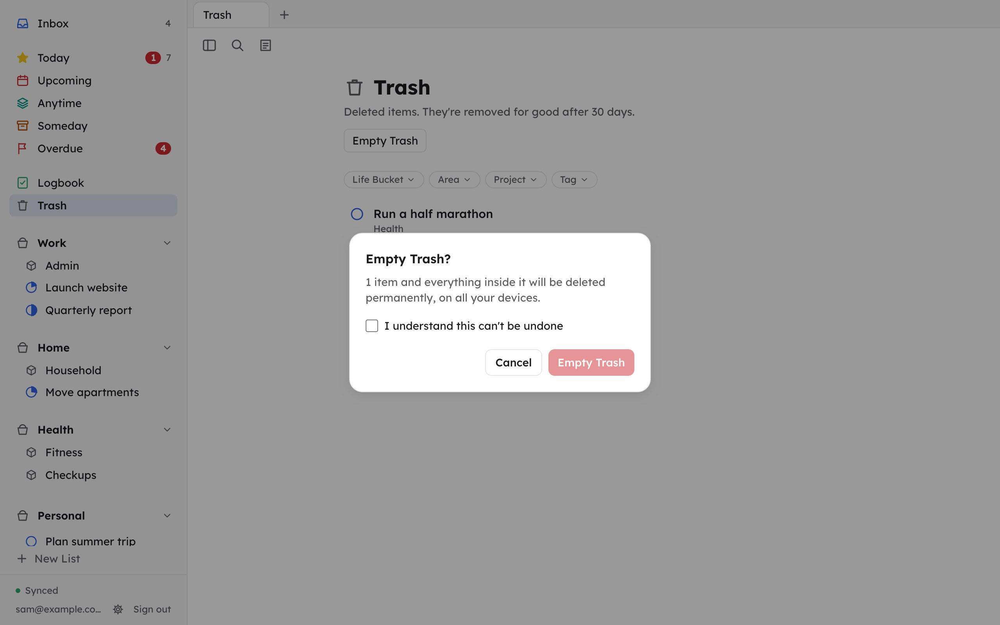

### 11.3 Undo and redo

- **⌘Z** undoes your last change and **⌘⇧Z** redoes it, for up to 50 steps.
- Some actions also show a toast with an **Undo** button (for example deleting a tag, or swiping a row away on a phone).
- Undo works across complex changes (moving a project with its to-dos, completing a project with its remaining to-dos).
- Undoing the creation of a to-do moves it to the Trash.
- Permanent deletions (emptying the Trash) can't be undone.
- While you're typing in a field, ⌘Z is the field's own undo.

---

## 12. Finding things: Quick Find

Start typing any letter while you're not in a text field (or click the **search** icon at the top) and **Quick Find** opens with what you typed:


It searches, as you type:

- Lists (Inbox, Today, Upcoming, Anytime, Someday, Overdue, **Deadlines**, Logbook, Trash).
- Life Buckets, projects and areas (with their Life Bucket), and tags.
- To-dos, by title and notes, with the project or area they're in. When only the notes match, the result shows the words around the match instead.
- **Task Notes**.

Use ↑ / ↓ and **Enter** to open a result, or click it. Opening a to-do takes you to the list it's in and opens it there. Lists and projects rank above to-dos when they match about as well. Escape closes it. With encryption on, search still works: it happens on your device.

The **g** shortcuts navigate without searching: **g i** Inbox, **g t** Today, **g u** Upcoming, **g a** Anytime, **g s** Someday, **g o** Overdue, **g l** Logbook, **g n** Task Notes. After **g**, the app waits a moment; any other letter opens Quick Find with both letters.

---

## 13. Keyboard shortcuts

Press **?** to see the list in the app:


⌘ means Ctrl on Windows and Linux. Shortcuts don't fire while you're typing in a field (except Alt+Space).

| Action                                   | Keys                                   |
| ---------------------------------------- | -------------------------------------- |
| New to-do (below the selection)          | Space or Alt+N                         |
| New heading (in a project)               | Alt+Shift+N                            |
| Quick Entry                              | Alt+Space                              |
| Quick Find                               | start typing                           |
| Open / close the selected to-do          | Enter / Esc                            |
| Move the selection                       | ↑ ↓ (Shift to extend)                  |
| Reorder the selection                    | ⌘↑ / ⌘↓                                |
| Complete / Cancel                        | ⌘K / ⌘⌥K                               |
| When…                                    | ⌘S                                     |
| Deadline…                                | ⌘⇧D                                    |
| Today / This Evening / Anytime / Someday | Alt+T / Alt+E / Alt+R / Alt+O          |
| Move to list…                            | ⌘⇧M                                    |
| Tags…                                    | ⌘⇧T                                    |
| Delete                                   | Backspace or Delete                    |
| Go to Inbox … Logbook                    | ⌘1 … ⌘6, or g i / t / u / a / s / l    |
| Go to Overdue                            | g o                                    |
| Go to Task Notes                         | g n                                    |
| Settings                                 | ⌘,                                     |
| Undo / Redo                              | ⌘Z / ⌘⇧Z                               |
| Shortcut help                            | ?                                      |

Inside an open to-do card:

| Action                                   | Keys                                   |
| ---------------------------------------- | -------------------------------------- |
| Close the card                           | Return (in the title), Esc or ⌘Return  |
| New checklist item below                 | Return (in a checklist item)           |
| Remove an empty checklist item           | Backspace                              |
| Insert a block in the notes              | / (then Enter); Esc closes the menu    |

Some browsers keep a few combinations for themselves in a normal tab (such as Chrome's ⌘1…⌘8); they work in the installed app, and the **g** shortcuts work everywhere.

---

## 14. Phones and tablets

mythings works just as well on a phone. Install it to your home screen for the best experience ([1.5](#15-installing-the-app)).

<table>
<tr>
<td></td>
<td></td>
<td></td>
</tr>
<tr>
<td>Today on a phone</td>
<td>The sidebar drawer</td>
<td>When, as a bottom sheet</td>
</tr>
</table>

- The sidebar is a **drawer**: open it with the button at the top left; tap outside it (or choose a list) to close.
- The floating **+** adds a to-do.
- **Tap** a row to open it.
- **Swipe right** on a row to open When. **Swipe left** to delete it (it asks first, and offers Undo).
- **Press and hold** a row to drag it; mostly vertical movements scroll as usual.
- Popovers (When, Tags, Deadline…) open as **sheets** from the bottom of the screen.
- Buttons and rows are finger-sized, and text fields are large enough that your phone doesn't zoom in.
- **Text size** (Settings → Appearance) can be set separately on each device.

---

## 15. Sync, offline and devices

- Every device keeps a full copy of your to-dos, so lists open instantly and everything works **offline**: add, edit, complete, move and delete as usual.
- Changes made offline are queued and sent when you're back online. The bottom of the sidebar shows the status:
  - **Synced** (green dot): everything is up to date.
  - **Syncing**, with a count of changes waiting.
  - **Offline · N changes will sync** (red dot), with an **Offline** badge at the top right of the window.

  

- Changes appear on your other devices within a second or two while they're online.
- On a new device, the app downloads your to-dos once after you sign in, then works offline from then on.
- A device that has never signed in shows "You're offline" and retries when the connection returns.
- The Privacy Policy and Terms of Service also work offline once the app has been opened.
- If two devices change the same thing while offline, the most recent change wins when they sync; changes to different fields of a to-do (say, its title on one device and its date on another) are both kept.

---

## 16. Settings

Open with the gear at the bottom of the sidebar, or **⌘,**. Changes apply at once. (While offline, changes to synced settings are put back with a message.)


The page has these sections, from top to bottom.

### 16.1 Appearance


- **Theme:** **System** (follows your device), **Light** or **Dark**. It's applied before the page even appears, so there's no flash of the wrong colors.

  

- **Text size:** Small, Default, Large, Larger. This device only, so you can use larger text on your phone than on your computer. On a computer you can also drag the sidebar's edge to resize it.
- **Long to-do titles:** **Wrap** (the default) shows the whole title in your lists, on as many lines as it needs. **One line** keeps each title on a single line ending in "…". An open to-do always shows its whole title and every checklist item in full. Saved with your account, so it's the same on all your devices.
- **Full width:** off by default, so lists sit in a centered column that's easy to read. Turn it on to let every list (and Task Notes) use the whole window. The **↔** button at the top of the page does the same. Saved with your account. On a phone, lists always use the whole screen.

### 16.2 Date & time


- **Time zone:** detected automatically ("Matches this device"); change it if you travel or it's wrong. It decides when "today" starts, when repeats appear and when reminders go off.
- **Week starts on:** affects calendars and "every N weeks" repeats.

### 16.3 Lists


- **Group to-dos in Today by project** (see [Today](#42-today)).
- **Move completed to-dos to the Logbook:** **Immediately** or **Daily** (see [Logbook](#47-logbook)).

### 16.4 Notifications


Shows whether this browser can show [reminders](#63-reminders), with **Turn on** to allow them. On iPhone and iPad, install the app to your Home Screen first.

### 16.5 Data


**Export…** and **Import…** (see [Your data](#18-your-data)).

### 16.6 Security

**End-to-end encryption** and **Passcode on this device**. Every screen is shown in [Encryption and passcode](#17-encryption-and-passcode).

### 16.7 Account


- **Signed in as** your email, with **Sign out**.
- **Name:** change it and choose **Save**. Leave it empty to remove your name.
- **Change password…:** asks for your current password and the new one; other devices are signed out. With encryption on, your to-dos stay readable with the new password.
- **Sign out of all devices…**, including this one.

### 16.8 About


- The app version, with **What's new** (the changelog).
- Links to the **Privacy Policy** and **Terms of Service**.

---

## 17. Encryption and passcode

### 17.1 End-to-end encryption

With end-to-end encryption on, the words in your account are encrypted on your own devices before they're saved or synced: to-do titles and notes, checklist items, and the names of projects, areas, Life Buckets, headings and tags. Only your devices can read them; the server stores them in a form nobody else can read, including us.

So that repeats, reminders and the Trash keep working, some details stay readable to the server: dates and deadlines, repeat settings, reminder times, whether something is completed or in the Trash, and how items are arranged.

It's off until you turn it on. In **Settings → Security** it looks like this:


**Turning it on**

1. Open **Settings → Security** and choose **Turn on encryption…**.
2. Your **recovery key** appears: eight groups of four letters and digits.

   

3. **Copy** or **Download** it (the download is a small text file) and keep it somewhere safe, such as a password manager. Don't keep it only on this device.
4. Tick **I've saved my recovery key somewhere safe**, enter **Your password**, and choose **Turn on encryption**.
5. Everything already in your account is encrypted in the background. Keep the app open and online for a moment; it finishes on its own the next time any of your devices is online, too.

When it's done, Security says **End-to-end encryption is on**:


Your other devices notice the change and ask for your password once (see below).

**Using encrypted to-dos**

Everything works as before: Quick Find, tags, repeats, reminders, drag and drop and offline use. Your devices decrypt as you go.

- **Signing in on a device:** your password unlocks your to-dos straight away.
- **A device that was already signed in** shows **Unlock your data** once: enter your password and choose **Unlock**.

  

- **Reminders** show the to-do's title on devices that can read it. On a device locked with a passcode, or one that can't read it yet, the reminder says only that a to-do is due.
- **Export** gives you a readable file, decrypted on your device. **Import** works as usual; imported items are encrypted on your device before they're saved.
- **Signing out** removes this device's ability to read your to-dos until you sign in again.

**Your recovery key**

The recovery key is the only way to read your to-dos if you forget your password: we can't reset encryption for you.

- After a **password reset**, a device that's already unlocked keeps working. Any other device shows **Unlock your data**: choose **Use my recovery key**, type the key (capitals, spaces and dashes don't matter) and your new password, then **Unlock**. From then on, the new password works everywhere.

  

- **New recovery key…** in Settings → Security makes a new one; the old one stops working. Save the new one just like the first.
- If you've lost both your password and your recovery key, choose **I don't have it** on the unlock screen to **start over**:

  

  You get a new recovery key and can keep using mythings, but anything encrypted before can't be read again and shows a lock (🔒). You can delete those items.
- **Changing your password** in Settings keeps everything readable; you don't need the recovery key for that.

**Turning it off**

Choose **Turn off…** in Settings → Security and enter your password. Your to-dos are decrypted on your devices and stored without end-to-end encryption again, and any passcode on this device is removed.

### 17.2 Passcode on this device

Once encryption is on, you can lock mythings on a device with a passcode. While it's locked, nothing on that device can be read without the passcode.

**Setting a passcode**

1. In **Settings → Security**, choose **Set passcode…**.
2. Enter a passcode of at least 6 characters in **New passcode** and again in **Repeat passcode**. Longer passcodes are harder to guess.
3. Choose **Save passcode**.


Security then shows the passcode controls:


- **Lock after** sets how soon it locks when you're away: **Right away** (as soon as you leave the app), **1 min**, **5 min** (the default) or **15 min** without a tap, click or key press. Reloading the page or reopening the app also asks for the passcode.
- **Lock now** locks it straight away.
- **Change passcode…** and **Remove** change or remove it.

**The lock screen**


- Enter the passcode and choose **Unlock**.
- A wrong passcode says so, and how many tries are left. After too many wrong tries in a row, the device forgets its key and you unlock with your password instead.

  

- **Forgot it?** Choose **Use your password instead**: you'll see [Unlock your data](#171-end-to-end-encryption) and can enter your account password.

The passcode belongs to that device only; your other devices have their own (or none). Changes you make while signed in still sync, and changes waiting to sync are sent once you unlock.

---

## 18. Your data

- **Export** (Settings → Data → **Export…**) downloads everything in your account, Trash included, as a JSON file. With encryption on, it's decrypted on your device first, so the file is readable: keep it somewhere safe.
- **Import** (Settings → Data → **Import…**) adds the contents of an export file as copies: to-dos, projects, areas, Life Buckets, headings, checklists and tags. Files exported before Life Buckets are rearranged the same way your account was ([8.3](#83-after-updating-to-life-buckets)). A message says how many items were imported.
  - Top-level tags with the same name are matched rather than duplicated.
  - Items that were in the Trash aren't imported.
  - Importing never overwrites or changes what you already have, so importing the same file twice gives you two copies.
- **Deleting your account:** export your data if you want it, then email us from your account's address (see the Privacy Policy) and we'll delete the account and everything in it.
- The [Privacy Policy](https://mythings.dynocoder.com/privacy) explains what's stored, why, and who processes it.

---

## 19. Public pages

These work without signing in:

- **Home** (`/`): what mythings is, with sign-up and sign-in ([1.1](#11-the-home-page)).
- **What's new** (`/changelog`): every release and what changed, newest first.
- **Privacy Policy** (`/privacy`) and **Terms of Service** (`/terms`).
- **Sign in** (`/login`) and **Sign up** (`/signup`).

---

## 20. Troubleshooting and FAQ

**Something I completed is still showing.** If Settings → Lists → Move completed to-dos to the Logbook is set to **Daily**, completed items stay (ticked) until the end of the day.

**My areas and projects look rearranged.** Since Life Buckets arrived, areas no longer hold projects; your lists were moved once, without losing anything. See [After updating to Life Buckets](#83-after-updating-to-life-buckets).

**A to-do with a later date is in Today.** Its deadline is today; deadlines bring items into Today on the day they're due.

**A to-do disappeared from Today.** Its deadline has passed, so it moved to **Overdue**. Set its When to Today to keep it in Today too, or give it a new deadline.

**A to-do scheduled for today isn't in Today.** Check its project: to-dos inside a Someday project, or a project scheduled for later, wait until the project is active.

**I can't find a to-do.** Start typing its title anywhere (Quick Find). If it was deleted, look in the Trash; if it was completed, in the Logbook. Check the tag bar isn't filtering the list.

**I can't reorder a list.** A tag filter is on; clear the tag bar first. Anytime, Someday, Upcoming and tag pages can't be reordered (only dragged to the sidebar).

**I don't get reminders.** Turn on notifications in Settings → Notifications and allow them in your browser or system settings. On iPhone and iPad, install the app to your Home Screen first. Check your time zone in Settings → Date & time.

**My changes didn't reach my other device.** Check the sync status in the sidebar. Offline changes are kept on the device and sent automatically when it's back online.

**A keyboard shortcut doesn't work.** You may be typing in a field (press Escape first), or the browser may keep that combination for itself: install the app, or use the **g** shortcuts.

**The sign-up or reset link doesn't work.** It may have expired or already been used; ask for a new one. Only the newest link works.

**I didn't get the sign-up or reset email.** Check your spam folder and that the address is right, then ask again after a short wait.

**My to-dos ask me to "Unlock your data".** Your account uses end-to-end encryption and this device can't read it yet. Enter your password; if you've reset your password since, use your recovery key.

**I forgot my passcode.** Choose **Use your password instead** on the lock screen.

**Some items show a lock (🔒) instead of a title.** They were encrypted with a key this device doesn't have, for example from before you started over without your recovery key. They can't be read; you can delete them.

**Can you recover my encrypted to-dos?** No. Only your password or your recovery key can unlock them. That's what keeps them private.

**Where's the Deadlines list?** It's hidden, as in Things: type "Deadlines" in Quick Find.

**Something else?** Report bugs or ideas on the [GitHub repository](https://github.com/duttalive/mythings/issues).
